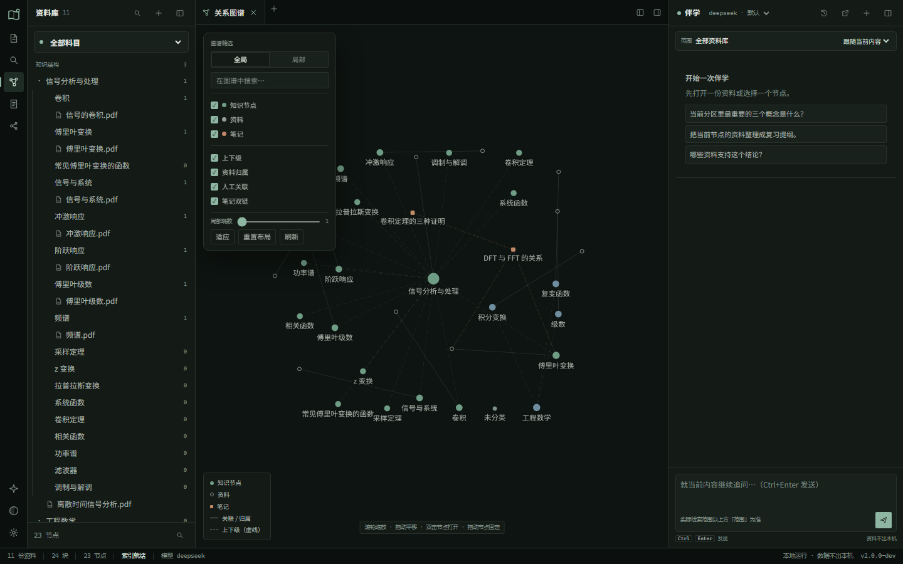
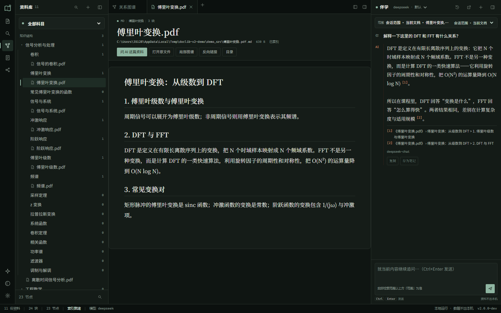
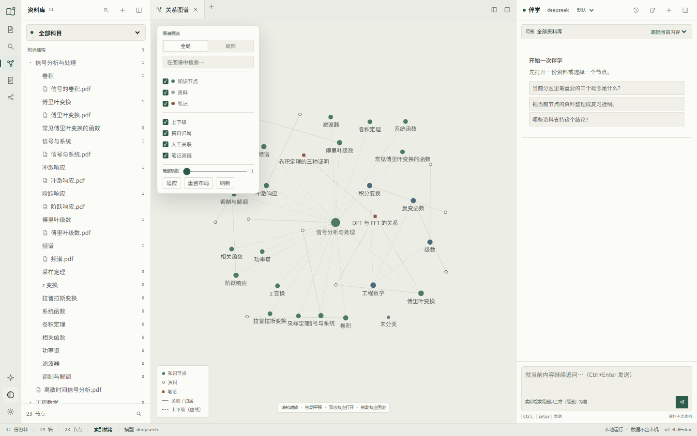
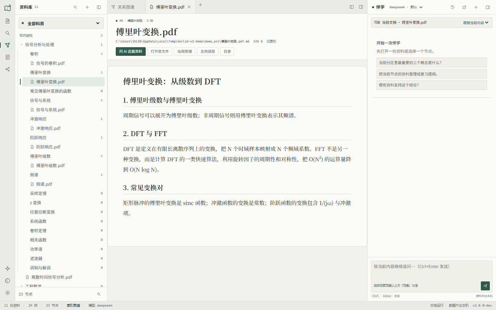
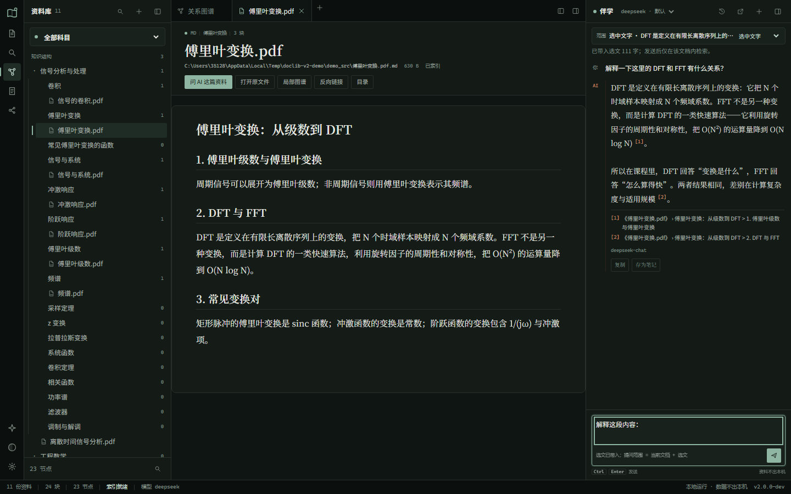
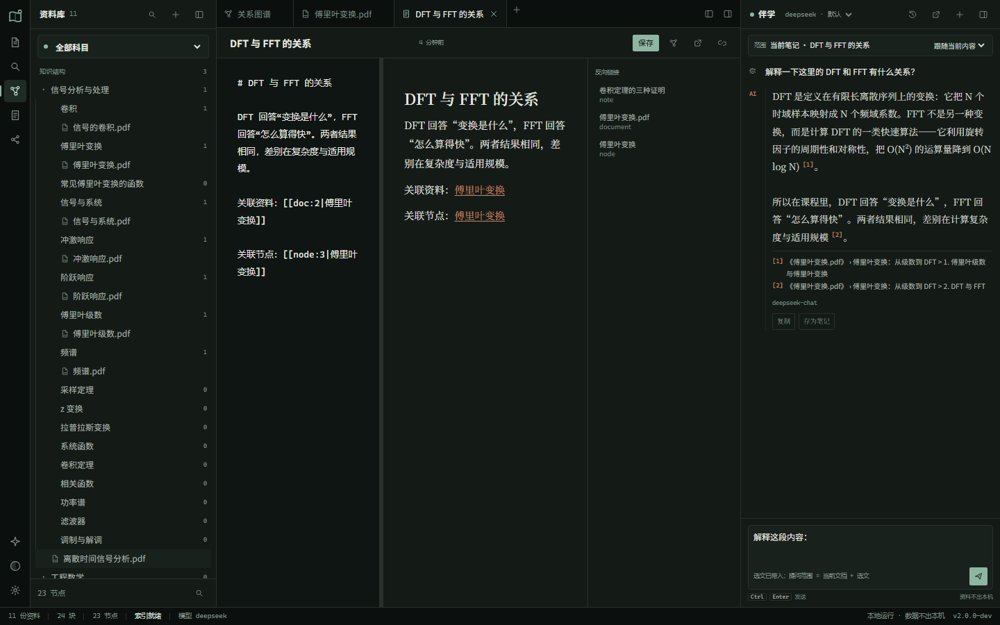

# DocLib 2.0 · 本地优先的 AI 知识工作台

> 版本 **2.0.0**（2026-11-19） ｜ 分支 `v2.0-dev` ｜ 基线 `v1.1.2-baseline`
> 纯本地、单机、零 CDN 依赖；资料与笔记默认不出本机，只有你自己配置的 AI 请求会出网。
> 设计方案与取舍见 [`docs/v2/`](docs/v2/)；本版把 DocLib 从「Word 资料库 + 导图」升级为「资料 / 图谱 / 阅读 / 笔记 / AI 伴学」统一工作台。



## 一、2.0 的核心变化

| 能力 | 2.0 的实现 |
|---|---|
| 统一三栏 | 左侧资料库（节点 + 资料叶 + 未归档 + 笔记），中间多标签工作区，右侧固定 AI 伴学；浅/深主题只改外观，不改布局 |
| 真正的知识图谱 | Cytoscape.js + fcose，实体为知识节点 / 资料 / 笔记；边为层级、挂载、手工关系、AI 关系、`[[wikilink]]`；支持全局/局部、实体与关系过滤、搜索、信息面板、树联动 |
| 文档阅读 | 独立阅读器：TOC/章节树、分页加载、Markdown/TXT 原文、PDF 原生 iframe + 解析文本回退、引用片段定位高亮、反向链接 |
| 上下文 AI | 支持分区 / 全库 / 节点 / 文档 / 笔记 / 选文六种范围；实际范围始终显示；切换中央内容不改变 AI 布局、不清空会话；引用可回跳原文 |
| 笔记与双链 | SQLite Markdown 笔记、自动保存与乐观冲突、笔记分块检索、`[[doc:id|别名]]` / `[[node:id|别名]]` / `[[note:id|别名]]`、反向链接、Markdown 导入导出 |
| 旧功能保留 | 分区、导入、搜索、AI 会话、模型/密钥、Word 问答导出、知识导图（嵌入中央标签页）、备份、回收站、重建索引、安全校验、MOTW |
| 安全与运维 | 迁移事务 + 迁移前备份 + 回滚；`schema_version=0007`；CSP、XFO SAMEORIGIN、Host/Origin/JSON 校验、Range 文件流、请求体上限 |

### 截图

| 深色 · 全局图谱 | 深色 · 阅读 + AI 会话 |
|---|---|
|  |  |

| 浅色 · 全局图谱 | 浅色 · 阅读 |
|---|---|
|  |  |

| 选文 → 问 AI | 笔记 / 双链 |
|---|---|
|  |  |

窄窗（1100/920）自动切为抽屉：资料库与 AI 仍可通过左侧/顶部按钮打开，详见 `docs/v2/screenshots/`。

## 二、快速开始

### 1. 打包版（推荐，无需 Python）

```text
dist-v2.0\DocLib\DocLib.exe          # 原生窗口（WebView2）
dist-v2.0\DocLib\DocLib.exe --browser --no-browser --port 8765
```

- 数据默认在 exe 同级的 `data/`，可整体拷走；首次启动自动建库/迁移。
- 从网上下载的压缩包如果窗口打不开：先双击 `解除锁定.bat`，或右键文件夹 → 属性 → 解除锁定。
- 浏览器模式：`--browser --no-browser`，然后打开终端提示的地址。
- 源码版：`python -m doclib serve --no-browser --port 8765`，或 `start.bat`。

### 2. 配置模型

1. 打开「设置 → AI 模型」，新增 provider（名称、OpenAI 兼容 base_url、model、key_ref）。
2. 在同一页「密钥」区填 `key_ref` 对应的键名和 API Key，点「保存密钥」；密钥用 Windows DPAPI 加密，界面不回显。
3. 回到右侧 AI 面板选择模型；没有配好密钥时不要发问，UI 会显示请求错误而不是伪造回答。

### 3. 数据目录

```text
data/
  doclib.db              # SQLite（WAL，FTS5 trigram）
  workspace.json         # 标签/面板/主题/宽度
  backups/               # 启动/手动/迁移前备份
  exports/               # Word 导出
  mindmaps/              # 旧版导图 JSON
  notes/                 # 保留目录（笔记正文在 SQLite）
```

## 三、开发与测试

```bat
python -m venv .venv
.venv\Scripts\python.exe -m pip install -r requirements.txt
.venv\Scripts\python.exe -m doclib serve --no-browser --port 8765
```

完整测试（全部使用临时 `DOCLIB_DATA`，不碰真实库）：

```bat
set PYTHONUTF8=1
.venv\Scripts\python.exe tests\smoke.py
.venv\Scripts\python.exe tests\test_scope_isolation.py
.venv\Scripts\python.exe tests\test_partitions.py
.venv\Scripts\python.exe tests\test_citations.py
.venv\Scripts\python.exe tests\test_mindmap_gen.py
.venv\Scripts\python.exe tests\test_graph.py
.venv\Scripts\python.exe tests\test_reader.py
.venv\Scripts\python.exe tests\test_notebook.py
.venv\Scripts\python.exe tests\test_context.py
.venv\Scripts\python.exe tests\test_migrations_v2.py
.venv\Scripts\python.exe tests\test_workspace.py
.venv\Scripts\python.exe tests\test_http_v2.py
.venv\Scripts\python.exe tests\test_notes.py
```

演示数据（临时库，不污染真实资料）：

```bat
set DOCLIB_DATA=%TEMP%\doclib-v2-demo
.venv\Scripts\python.exe scripts\make_demo.py
.venv\Scripts\python.exe scripts\fake_llm.py
.venv\Scripts\python.exe -m doclib serve --no-browser --port 8765
```

打包（输出到独立目录，避免覆盖已有 `dist/DocLib/data`）：

```bat
.venv\Scripts\python.exe -m PyInstaller --noconfirm --distpath dist-v2.0 --workpath build-v2.0 DocLib.spec
```

## 四、兼容性

- 旧 API `/api/*`、`/api/rev/*` 保留；新前端使用 `/api/rev/*` + `/api/v2/*`。
- 旧 `data/doclib.db` 会在启动时事务迁移到 `0007`，迁移前自动备份；旧资料、导图、密钥不删除。
- 旧知识导图仍在「知识导图」入口，以 `?embed=1&theme=` 嵌入中央标签页；原页面可单独打开。
- 向量/语义检索仍为可选源码能力，打包版不内置 onnxruntime/numpy，以控制包体。

## 五、已知限制（2.0.0）

- PDF 的 WebView2 原生预览与解析文本回退已实现，但本机没有 PDF 样例做完整视觉回归；PDF 页码/坐标引用目前以解析块定位为主。
- 笔记编辑器是“纯 textarea + 实时预览”，不是 CodeMirror 6；分屏、命令面板、未链接提及、标签拖拽属于 P1，没有在 2.0.0 强行加入。
- 全库范围已支持（图谱“全部科目”、AI“全部资料库”）；但模型回答质量取决于你的 provider 与资料质量。
- 打包产物未做数字签名；首次运行可能被 SmartScreen 提醒。
- `tests/qa_regress.py` 需要真实 `dist/DocLib/data` 语料；仓库不带真实资料，所以没有在 CI 中伪造通过。

## 六、为什么这样设计

- 三栏的信息架构来自 Obsidian/Logseq 的长期使用反馈：资料树提供稳定位置感，中央标签承载阅读/编辑，右侧 AI 与当前内容保持“可对照”关系。
- 浅色与深色只动 token，不动尺寸：颜色是外观，布局是产品承诺。
- 引用必须可回原文，AI 的“范围”必须可见；不能把“当前选文”悄悄变成“全库”。
- 迁移必须可回滚；用户数据比新功能重要。

## 七、许可与来源

MIT，见 [`LICENSE`](LICENSE)。前端依赖与许可见 [`THIRD_PARTY_NOTICES.md`](THIRD_PARTY_NOTICES.md)。未复制 Logseq / 思源（AGPL）代码；只参考公开交互与架构。

---

<details>
<summary>v1.1.2 的旧版功能与界面说明（保留）</summary>

- 旧版主界面、导图、Word 导出、备份/回收站/密钥/安全校验仍可用。
- 旧版截图见 `docs/screenshots/`；旧变更见 `CHANGELOG.md` 的 v1.x 段。
- 旧版详细使用说明保留在 Git 历史与 `docs/`。

</details>
