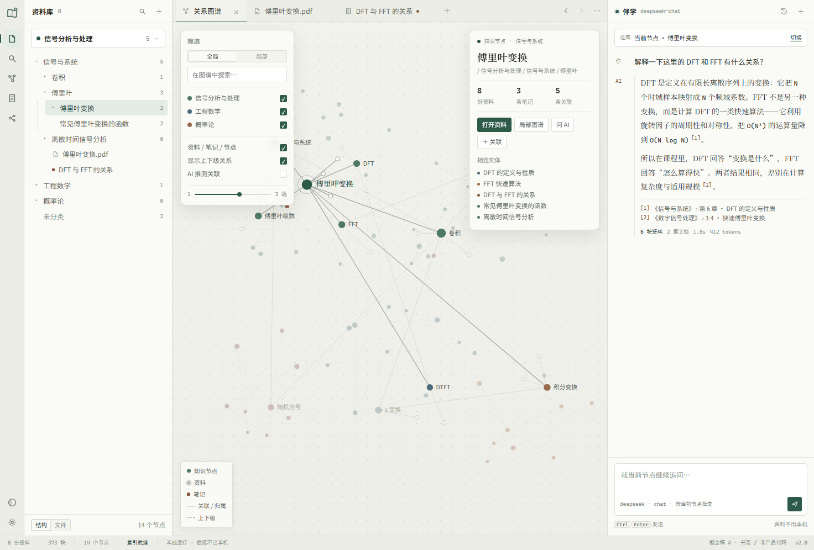
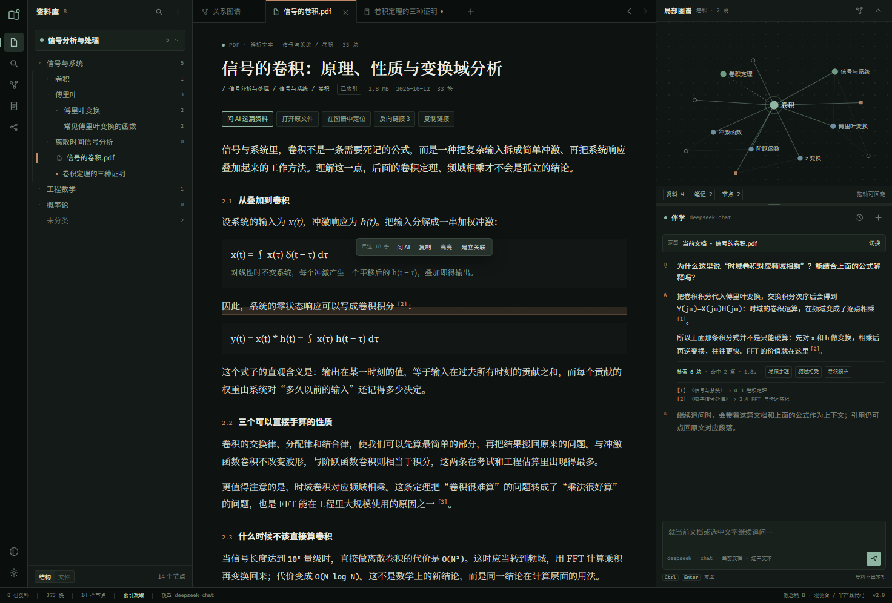

# DocLib 2.0 视觉与交互设计系统（待批准）

> 状态：Plan Mode 产出。依据官方 `frontend-design`、`ds-design` 与对真实源码的审计。
> 本文中的两张图是**独立视觉概念稿**（`concepts/study.html`、`concepts/observatory.html`），不是业务页面，不含产品逻辑；Phase 1 会用真实组件重建。
> 现有产品基线：v1.1.2 / build 2026-11-19-r16，单文件 `index.html`（1837 行）+ `mindmap.html`（1902 行）。

---

## 1. 产品、用户与场景

DocLib 不是通用笔记软件，也不是 SaaS 仪表盘。它的真实使用场景是：

- 一名中国工科本科生（信号与系统、工程数学、概率论、无人机项目）在 Windows 笔记本上，用 40–90 分钟连续阅读 Word/PDF/PPT 课程资料。
- 阅读中频繁出现“这一段没懂”“和另一章是什么关系”“考试会怎么问”，需要一个能引用原文、能定位来源、不会编造的 AI。
- 资料是别人给的、不可编辑的；自己的理解必须另存为笔记，并能与资料、知识点建立关系。
- 需要把一门课的结构、章节、资料、笔记看成一张图，而不是一堆文件。
- 长期使用，夜间也读；视觉必须耐看、低干扰、信息密度合理。

因此产品的主任务是 **读—查—连—问**：
**读**当前资料 → **查**它在知识结构中的位置 → **连**到相关实体 → **问** AI 并回到原文。
图谱是“查/连”的主视图，AI 是贯穿始终的工作区，不是独立页面；文档是中心内容，不是卡片列表。

### 设计必须避免的“AI 网页味”

- 不是紫蓝渐变、玻璃拟态、发光边框、通用 SaaS 卡片。
- 不是把 Obsidian 的深灰紫界面换一套颜色照搬。
- 不是把“知识图谱”做成随机连线背景。
- 不是一屏塞满巨大按钮和低密度卡片。
- 不是只做首页好看，而阅读、空态、错误、加载、长文、长会话都不成立。

---

## 2. 最终布局与两套主题（2026-11-19 用户批准）

### 2.0 三条不可更改的原则

1. **浅色/深色只是外观主题，不是两套布局。** 切换主题只改颜色、字体色、边框、图标色、强调色、图谱视觉和必要阴影；三栏尺寸、标签位置、面板展开状态、AI 面板结构一模一样。
2. **文件、笔记、全局图谱、局部图谱、知识导图、搜索结果全部在中央多标签工作区内切换。** 局部图谱是中央标签页内容，不是常驻侧栏。
3. **右侧 AI 伴学面板始终是方案 A 的完整三栏比例和独立空间。** 它占满右侧工作区高度；不得在它上方/下方增加常驻局部图谱、资料预览或其他挤占聊天空间的面板；不得因中央切到图谱/文档而变形、缩小、移动或变成上下分栏。

### 2.1 唯一工作区结构（A）



- 左：Ribbon + 资料库树（学科分类、节点、资料、笔记、搜索、图谱入口）。
- 中：多标签工作区（全局图谱、局部图谱、PDF/Word/PPT 阅读、Markdown 笔记、现有导图、搜索结果、节点概览）。
- 右：AI 伴学（模型/会话操作/上下文选择 → 可滚动对话 → 固定输入区），**完整高度，默认 374px，可手动调宽/折叠**。
- 下：26px 状态条。
- 文档阅读是中央标签页里的“纸页”；图谱是中央标签页里的“索引地图”；二者共用同一套标签/面板规则。

### 2.2 深色主题（B 只提供配色与氛围）



> **注意**：上图右侧的“局部图谱 + 伴学”上下分栏是**被明确否决的 B 布局**，仅保留其深色配色、文字对比、细线结构作为主题参考。最终实现中，右侧只有 AI 伴学一个完整面板；局部图谱必须出现在中央标签页。

深色是**默认主题**（用户偏好），浅色是完整高质量替代：

| 维度 | 浅色主题 | 深色主题（默认） |
|---|---|---|
| 背景/表面 | 冷调矿物纸、纸页 | 墨绿黑、深面板 |
| 文字 | 墨色/次要灰绿 | 暖白/灰绿 |
| 强调 | 松烟绿；朱赭引用 | 鼠尾草绿；赭石引用 |
| 图谱 | 纸面点阵 + 墨色节点 | 深色场 + 低饱和节点 |
| 布局 | **完全相同** | **完全相同** |
| 面板宽度/折叠 | **完全相同** | **完全相同** |
| 组件结构 | **完全相同** | **完全相同** |

### 2.3 中央内容与 AI 上下文联动（布局独立）

- 中央标签切换会更新 AI 的**可选上下文**（当前文档/节点/选文），但不会清空会话、不会改变 AI 面板布局、不会自动把上下文塞给模型。
- AI 面板始终显示**当前实际检索范围**（如“当前文档 · 信号的卷积.pdf”“当前节点 · 傅里叶变换”“选文 18 字”），避免用户误以为 AI 理解了全部可见内容。
- 选中文本 → 工具条“问 AI” → 选文进入 AI 输入区（可编辑后再发送）；引用点击 → 中央打开/定位文档，AI 面板保持原会话。
- 局部图谱从图谱节点/文档“局部图谱”动作打开为**中央标签**；AI 面板内只允许轻量上下文标签/引用列表/按需弹层。

### 2.4 视觉气质

- A 的纸页/索引/边注作为统一结构；B 的墨绿黑/鼠尾草绿/赭石作为默认深色主题。
- 不是把 Obsidian 的深灰紫换色；不是通用 SaaS 卡片；不做紫蓝渐变/玻璃拟态/发光。
- 字体：UI `Noto Sans SC` / 阅读 `Noto Serif SC` / 元数据 `Cascadia Mono`；离线、无 CDN。
- 细规则线承担结构；圆角克制（控件 2–4px，浮层 8px）；阴影只用于浮层。
- 这套结构在 1440/1920/1100/920 下保持同一套组件，只做折叠/抽屉，不换布局。

---

## 3. Design Tokens

### 3.1 字体

| 角色 | 字体栈 | 用法 |
|---|---|---|
| UI | `"Noto Sans SC","Microsoft YaHei UI","Segoe UI",system-ui,sans-serif` | 导航、树、标签、按钮、表单、AI 元信息 |
| 阅读 | `"Noto Serif SC","Source Han Serif SC","SimSun",serif` | 文档正文、笔记预览、AI 回答正文、图谱选中标题 |
| 等宽 | `"Cascadia Mono","Consolas",monospace` | 计数、ID、路径、时间、检索轨迹、页码 |

- 本机已安装 `Noto Sans SC` / `Noto Serif SC` 可变字体；分发到无此字体的机器时回退到微软雅黑/宋体。v2.0 **不打包字体**（包体与授权复杂度），在 README 说明推荐安装；若后续需要一致渲染，再以 OFL 子集方式打包（P2）。
- 不使用 Inter/Roboto/系统字体作为展示字体；不引入 Google Fonts/CDN。
- 正文行宽：中文 32–40 字/行（约 680–760px @16.5px），拉丁 < 80 字符；阅读行高 1.9，UI 1.55。

### 3.2 字号与字重

| Token | 值 | 用途 |
|---|---|---|
| `--fs-11` | 11px | 计数、极小元信息（慎用） |
| `--fs-12` | 12px | 次要标签、树行、tab |
| `--fs-13` | 13px | UI 正文、按钮 |
| `--fs-14` | 14px | 侧栏标题、AI 正文 |
| `--fs-16` | 16px | 视图标题、阅读小标题 |
| `--fs-20` | 20px | 阅读 h2、面板标题 |
| `--fs-28` | 28–30px | 文档标题 |
| `--lh-ui` | 1.55 | UI |
| `--lh-read` | 1.9 | 阅读 |
| `--lh-tight` | 1.3 | 大标题 |

- 字重：400 正文，500 UI 强调，600 标题；中文不用 700 以上，避免糊。
- 不使用全大写 + 字距作为“ eyebrow ”；章节号、类型标签只在其确实表达结构时出现。

### 3.3 颜色（浅色）

| Token | 值 | 用途 |
|---|---|---|
| `--bg` | `#F2F2EC` | 应用底、图谱底 |
| `--surface` | `#FBFBF7` | 面板、阅读纸页 |
| `--surface-2` | `#F0F0E8` | 悬停、次级底 |
| `--surface-3` | `#E7E8DE` | 选中底、分隔 |
| `--ink` | `#1F2420` | 主文字 |
| `--ink-2` | `#58625B` | 次要文字 |
| `--ink-3` | `#6B766E` | 元信息（≥4.5:1） |
| `--line` | `#DCDDD3` | 结构线 |
| `--line-strong` | `#C9CBC0` | 强调边界 |
| `--accent` | `#2E5A4A` | 主操作、活动态、链接 |
| `--accent-hover` | `#244A3C` | hover |
| `--accent-soft` | `#E2EBE4` | 选中底、光标行 |
| `--cue` | `#8A5A44` | 引用编号、AI 边注、笔记点 |
| `--cue-soft` | `#F0E4DC` | 引用 hover/高亮底 |
| `--mark` | `#EAD9A7` | 搜索/选中高亮 |
| `--danger` | `#A64032` | 错误、危险操作 |
| `--warn` | `#8A651F` | 警告 |
| `--focus` | `#2E5A4A` | 焦点环 |

学科/图谱色（浅色）：

| Token | 值 |
|---|---|
| `--n1` 松绿 | `#4E7A63` |
| `--n2` 黛蓝 | `#4D6A7A` |
| `--n3` 赭石 | `#9A6A4C` |
| `--n4` 藤黄 | `#B08A3E` |
| `--n5` 绛 | `#7E4A56` |
| `--n6` 灰青 | `#6E7F79` |

### 3.4 颜色（深色 / 夜读）

| Token | 值 |
|---|---|
| `--bg` | `#0F1512` |
| `--surface` | `#161D19` |
| `--surface-2` | `#1B2420` |
| `--surface-3` | `#222C27` |
| `--ink` | `#E5E7DF` |
| `--ink-2` | `#A8B1A9` |
| `--ink-3` | `#93A099` |
| `--line` | `#2A332D` |
| `--line-strong` | `#3A453E` |
| `--accent` | `#8FB6A2` |
| `--accent-hover` | `#A8C9B8` |
| `--accent-soft` | `#223029` |
| `--cue` | `#C18A67` |
| `--cue-soft` | `#33241D` |
| `--mark` | `#4A4026` |
| `--danger` | `#D07A68` |
| `--warn` | `#C9A15E` |
| `--focus` | `#8FB6A2` |

图谱色（深色）：`#6F9C85 #6F8FA0 #B08A68 #B39A5E #9B6B76 #7E948B`；图谱底 `#0E1411`。

规则：主色只用于操作/活动态/链接；朱赭只用于引用/边注/笔记；大面积使用纸色/墨色；不使用渐变作为装饰；不使用发光。

### 3.5 间距、圆角、边框、阴影

- 间距基数 4px：`2/4/8/12/16/20/24/32/40/56`；不出现 7、9、11、13 这类偶然值。
- 圆角：控件 `2px`，面板/弹层 `4px`，大浮层 `8px`；不出现 10/14/20 混用。
- 边框：`1px solid var(--line)`；结构分隔优先用线，不用阴影。
- 阴影：仅用于浮层（筛选面板、命令面板、菜单、对话框）：`0 10px 30px rgba(28,38,31,.12)`；面板本体无阴影。
- 密度：树行 28px，标签 40px，状态条 26px，按钮 28/32px；不出现 44px 以上的主按钮（触控不是主目标，但键盘/触控板可点区域 ≥28px）。

### 3.6 动效

| 场景 | 时长/曲线 | 说明 |
|---|---|---|
| tab 切换/悬停 | 90–140ms `cubic-bezier(.2,.7,.3,1)` | 只改变底色/下划线/透明度 |
| 面板展开/收起 | 140ms | 宽度/透明度；不弹跳 |
| 图谱选中/邻居高亮 | 160ms | 非邻居降透明；选中环出现 |
| 图谱布局 | 力导向自然收敛 | 不播放“生长动画”作为装饰 |
| 命令面板/菜单 | 120ms | 淡入 + 2px 位移 |
| 加载 | 骨架条/旋转器 | 不用满屏遮罩 |

- 除“内容加载”外不做自动播放动画；不做逐卡片 fade-in。
- `prefers-reduced-motion: reduce` 下关闭所有非必要过渡与图谱高亮动画。
- 焦点可见：2px accent ring + 2px offset；不允许 `outline:none` 无替代。

---

## 4. 布局

### 4.1 应用骨架（桌面）

```
┌────┬──────────────────┬─────────────────────────────────────┬────────────────┐
│ 44 │ 资料库 8    ⌕ ＋ │  关系图谱 ×   傅里叶变换.pdf ×  笔记 ×  ＋ │ 伴学  ●  历史  │ 40 tabs
│    │ 信号分析与处理 ▾ │─────────────────────────────────────│ 范围 当前节点   │
│ ▤  │ ▾ 信号与系统  5  │                                     │ ┌────────────┐ │
│ ⌕  │   ▸ 卷积     1   │       文档纸页 / 图谱画布            │ │ 问答流      │ │
│ ⌁  │   ▸ 傅里叶   3   │                                     │ │ 引用 [1][2] │ │
│ ✎  │     ▸ 傅里叶变换 │                                     │ └────────────┘ │
│ ⬡  │       资料.pdf   │                                     │ [输入……]  ➤   │
├────┴──────────────────┴─────────────────────────────────────┴────────────────┤
│ 8 份资料 · 373 块 · 14 节点 · 索引就绪 · 本地运行                  v2.0      │ 26
└──────────────────────────────────────────────────────────────────────────────┘
```

- 网格：`44px 268px minmax(0,1fr) 374px` + 底部 26px；左右栏可折叠、可拖宽。
- 宽度约束：左 220–360，右 320–480；中心最小 520。
- 1440×900：中心约 754px；1920×1080：中心约 1234px，阅读列 max 760px 居中，图谱铺满。
- 1100px：右栏变为可呼出的抽屉（不是 `display:none`），左栏可收起；920px：左栏抽屉 + 右栏 sheet；窗口最小 920×620。
- 不使用“全局顶栏 + 再一排标签”的双层 chrome；Ribbon + 树头 + 标签条足够。原生窗口标题栏保留，不自定义拖拽区。

### 4.2 左侧

- Ribbon：品牌标记、资料、搜索、图谱、笔记、导图；底部主题/设置。活动态用 2px 左线 + soft 底，不用整块深色。
- 资料库头：标题 + 数量 + 搜索/导入。
- 分区切换：一行下拉，显示当前分区与数量。
- 树：知识节点 + 资料 + 笔记；支持展开/折叠、计数、类型图标、拖拽挂载、右键菜单；“结构/文件”分段切换。
- 活动行：浅 accent-soft 底 + 左侧 2px 线；资料行用文件图标；笔记用小朱点。
- 树行高 28px；长名称省略并在 tooltip 显示全名；不做低密度卡片。

### 4.3 中央标签页

- 标签高 40px；图标 14px；标题 12.5px；关闭按钮 hover 显示；脏状态用 5px 朱点。
- 活动态：纸色底 + 底部 2px accent 线（A）；B 用顶部 1px 赭线（概念差异，最终只取 A）。
- 标签类型：图谱、文档、笔记、导图、搜索、节点概览、设置；每类有稳定图标。
- 标签上限 12/窗格；超出提示关闭；固定标签（P1）不被导航替换。
- 右键：关闭、关闭其他、在右侧打开（P1）、在图谱中定位、固定、复制链接。
- 拖动排序（P1）；关闭后可用 `Ctrl+Shift+T` 恢复（P1）。
- 所有标签内容独立滚动；标签条不随内容滚动。

### 4.4 阅读器

- 文档头：类型/路径/块数（mono，9–10px），标题（衬线 27–30px），元信息行，操作行（问 AI、打开原文件、在图谱中定位、反向链接、复制链接）。
- 正文列 ≤760px；段落 16.5px/1.9；标题用衬线或 UI 无衬线（A 用衬线）；引用标记朱色上标。
- 目录：可折叠左栏（160–200px）或顶部“大纲”按钮；章节锚点与滚动同步；P1 做 sticky TOC。
- 搜索：浏览器原生 Ctrl+F + 应用内查找（P1）。
- 选中文本：浮动工具条（问 AI / 复制 / 高亮 / 建立关联），距选区 8px，键盘 Esc 关闭。
- 引用定位：滚动到 chunk，`data-chunk` 锚点 + CSS Highlight API 高亮引用文本；PDF 若支持页号，提供“在 PDF 第 N 页查看”。
- 阅读模式：Markdown/TXT 渲染原文；DOCX/PPTX 用解析块（标题路径 + 正文），明确“解析文本，非原版排版”；PDF 用内嵌阅读器（Phase 3 spike），并提供“解析文本”备用标签。
- 空/加载/错误：骨架、文件丢失、解析失败、无文本层、模型不可用，各有下一步操作。

### 4.5 知识图谱

- 画布：浅色 `#ECEDE5` + 22px 点阵；深色 `#0E1411` + 20px 点阵；无渐变。
- 节点：知识节点实心圆（半径 4–14，按度数 sqrt/log）；资料空心圆（2.5–4）；笔记小方块（2.5–3.5）；选中环 + 标题；标签只在缩放 >0.8、hover、选中或搜索命中时显示。
- 边：层级虚线（2 4），归属/关联实线，wikilink 点线，AI 推测虚线低透明；宽度 0.7–1.2px；默认透明度 0.16–0.25，邻居 0.55。
- 悬浮筛选面板（左上，206px）：全局/局部、搜索、学科复选、类型复选、关系复选、跳数滑块（1–3）；收起为图标。
- 选中信息面板（右上，236px）：类型、标题、路径、资料/笔记/关联计数、动作（打开资料、局部图谱、问 AI、建立关联）、相连实体列表。
- 底部图例：知识/资料/笔记/关联/层级；不堆叠卡片。
- 交互：拖动固定节点；滚轮缩放；空白拖拽平移；hover 邻居高亮；单击选中；双击打开；右键菜单；`F` 适配；`R` 重置布局；搜索定位。
- 性能：全局默认上限 1500 节点（可调 2000），超出提示“已截断，建议聚焦分区”；局部图 ≤800；5k 数据只做局部/筛选视图。
- 布局状态：筛选、缩放、平移、固定节点位置保存；重开恢复；提供“重置布局”。

### 4.6 AI 伴学

- **结构不变量**：AI 面板占满右侧工作区高度；头部（模型/会话）→ 可滚动消息区 → 固定输入区；不得在其中增加常驻局部图谱、资料预览或其他挤占聊天空间的面板。
- 面板头：状态点 + “伴学” + 模型（mono）+ 历史/新对话。
- 上下文条：`范围` + 目标（当前分区/节点/文档/选文/笔记）+ `切换`；不可用模式禁用并解释。
- 消息流：无气泡；左侧 26px gutter 标“你 / AI”；回答正文左 1px 朱线，衬线 14px/1.85；引用 `[n]` 朱色上标；来源列表在回答底部；检索轨迹（块数/文档数/耗时/tokens）用 mono。
- 长对话：面板独立滚动；只渲染最近 50 条，向上加载更多；输入框 sticky。
- 上下文真实生效：范围 chip 必须对应请求体 `context`；回答元信息显示 `context`；切换后旧消息保留原 context 标记。
- 引用跳转：点击 `[n]` 打开/聚焦文档标签，滚动到 chunk，高亮约 2 秒；笔记引用打开笔记并定位标题。
- 资料不足：inline 提示“资料不足：没有可引用的原文片段”，不伪造来源；给出“扩大范围/换模型/查看检索”的行动。
- 错误：模型未配置、401、超时、网络、服务端 500，各有人话文案与下一步；不显示 Python traceback。
- 空态：首次使用展示 3 个真实可点的示例问题（基于当前上下文），不写空话。
- P1：检索轨迹展开、AI 回答“存为笔记”、上下文快捷切换、流式输出（需 SSE，P2）。**不做常驻局部图谱侧栏。**

### 4.7 笔记

- 列表/树：笔记作为朱点节点出现在树中；可新建、搜索、按分区/节点过滤。
- 编辑器：标题输入 + Markdown 源文 + 预览（左右分栏，窄屏切换）；CodeMirror 5（MIT）提供行号、搜索、Markdown 模式；工具栏只有少量动作（加粗/标题/链接/引用/关联）。
- 双链：输入 `[[` 弹出实体选择器（笔记/文档/知识点），显示类型与分区；插入 `[[note:12|标题]]` 或 `[[doc:12|标题]]`（稳定 ID 形式）；人类可读标题由后端解析。
- 反向链接：文档/笔记右侧或底部面板，分“已链接 / 未链接提及（P1）”；点击跳转。
- 自动保存 800ms + 显式保存；脏点；冲突对话框；保存失败保留草稿。
- AI 整理：回答下方“存为笔记” → 生成带来源引用的 Markdown 笔记，链接到上下文文档/节点，打开编辑器。
- 不把 PDF/Word 原文伪装成可编辑 Markdown；笔记是独立实体。

### 4.8 搜索、命令面板、导航

- 搜索：`Ctrl+Shift+F` 打开“搜索”标签页，输入 + 分区/类型过滤 + 结果分组（资料/笔记/节点），高亮命中，键盘上下选择，Enter 打开。
- 快速打开：`Ctrl+P` 命令面板，模糊匹配标题/命令；最近使用置顶；分组“资料/笔记/节点/命令”；全键盘可用。
- 导航：每标签/窗格历史（docId + anchor + scrollTop）；Alt+←/→；新跳转清空前进栈；重启恢复（P1 每窗格独立）。
- 快捷键：Ctrl+P、Ctrl+Shift+F、Ctrl+B（左栏）、Ctrl+Alt+B（AI）、Ctrl+W、Ctrl+Tab、Ctrl+S、Alt+←/→、Esc；设置页可改（P1）。
- 右键菜单：树、标签、正文、图谱、引用五类；与命令注册表共用 command id。

### 4.9 设置与状态

- 设置作为标签页（不是大模态）：外观（主题/字号/密度）、AI（模型、密钥、测试、调用记录）、数据（备份、重建索引、回收站、工作区重置）、关于/诊断。
- 状态条：资料/块/节点计数、索引状态、当前模型、保存状态、版本；点击打开诊断。低干扰，26px，mono 9.5–10px。
- Toast：底部居中，3 秒，最多 2 条；错误 toast 可点开详情。
- 对话框：统一 `dialog` 组件，焦点陷阱、Esc、遮罩关闭、危险操作二次确认；不使用 `prompt/confirm`。

---

## 5. 关键状态与文案

| 状态 | 表现 | 文案原则 |
|---|---|---|
| 首启空库 | 中央欢迎页：导入资料 / 配置模型 / 看示例图谱；右侧 AI 空态 | 说“下一步做什么”，不写“欢迎使用强大…” |
| 资料导入中 | 进度条 + 当前文件名 + 已导入/失败数；可取消（P1） | 失败给出文件与原因，不只“失败” |
| 索引中 | 状态条“索引中 42/373”；相关按钮 disabled 有说明 | 明确会持续多久/可否继续读 |
| 文档缺失 | 标签内提示“源文件不在此位置”，操作：重新定位/删除记录/打开回收站 | 不崩溃、不空白 |
| 解析质量低 | 文档头“解析质量低”，提示 OCR/原文件 | 不阻断阅读 |
| 模型未配置 | AI 面板提示 + 去设置；不自动弹窗 | 不把设置强塞给用户 |
| 模型错误 | 回答位置显示错误 + 重试/换模型/复制诊断 | 不显示 traceback/密钥 |
| 资料不足 | inline 朱色提示 + 来源为空 | 明确“没有可引用片段” |
| 图谱为空 | 画布中央“还没有可显示的关系”，操作：导入/创建笔记/检查筛选 | 区分“没数据”和“筛选后为空” |
| 搜索无结果 | 显示查询词 + 建议扩大范围/换词 | 不显示空白 |
| 保存冲突 | 对话框对比本地/服务器版本，选择保留/合并 | 不静默覆盖 |
| 图谱截断 | 顶部条“显示 1500/3200 节点”，操作：聚焦分区/降低跳数 | 明确数据未丢 |

---

## 6. 可访问性与响应式

- 对比度：正文/次要文字 ≥4.5:1；大标题 ≥3:1；不以颜色单独传达状态（选中同时有边框/图标/文字）。
- 键盘：所有树行、标签、菜单、对话框可 Tab/方向键操作；焦点环可见；图谱提供“列表视图”替代（选中信息面板的相连实体列表）。
- 触控：可点区域 ≥28px（桌面），关键操作 ≥32px；拖拽有键盘替代（菜单命令）。
- 语义：`nav/aside/main/section`、`button`、`aria-current`、`aria-expanded`、`aria-label`；图谱节点 SVG 有 `<title>`/可聚焦列表。
- 响应式：1440/1920/1100/920；无横向滚动；窄屏 AI 以抽屉/sheet 可达；树可收起。
- 降低动效：`prefers-reduced-motion` 禁用过渡；图谱布局仍收敛但不做高亮动画。

---

## 7. 视觉验收清单

### 7.1 截图矩阵（必须真机渲染）

| # | 尺寸 | 主题 | 场景 |
|---|---|---|---|
| 1 | 1440×900 | 浅 | 图谱 + 标签 + 树 + AI 多轮 |
| 2 | 1440×900 | 深 | 同上 |
| 3 | 1440×900 | 浅 | 文档阅读 + 选区工具条 + 引用跳转 |
| 4 | 1440×900 | 深 | 笔记编辑 + 双链 + 反链 |
| 5 | 1920×1080 | 浅 | 图谱全屏 + 筛选 + 信息面板 |
| 6 | 1100×700 | 浅 | AI 抽屉 + 树收起 |
| 7 | 920×620 | 深 | 最小窗口：标签滚动 + AI sheet |
| 8 | 1440×900 | 浅 | 空库/加载/错误/资料不足 四态拼图 |

### 7.2 判定

- 无横向滚动；无文字被面板/浮层永久遮挡；无低对比文本（用工具抽查）。
- 1440 下中心阅读列 ≥620px，图谱画布 ≥640px；1920 下阅读列 ≤760px。
- **同一场景浅/深切换，三栏宽度、标签位置、AI 面板高度与展开状态完全不变**；只有颜色/字体色/边框/图标色/图谱表现变化。
- **AI 面板始终完整高度**：头部 → 消息滚动区 → 输入区；任何中央标签打开/切换/关闭都不改变其尺寸或结构。
- 标签切换、树选中、图谱选中、AI 引用四类反馈 ≤160ms 且不跳动布局。
- 所有 interactive 元素有 hover/focus/active/disabled；空/加载/错误态存在。
- 没有紫蓝渐变、玻璃拟态、发光、全屏大卡片、emoji 图标、同一圆角/阴影堆叠。
- `ds-design-audit` 评分 ≥ 目标阈值（Phase 5 设定，建议 8/10），问题逐条修复后重截图。

### 7.3 概念稿说明

- `concepts/study.html`、`concepts/observatory.html` 是静态概念稿；A 验证统一三栏与浅色，B 只验证深色配色/对比/细线，**B 的右侧上下分栏布局已被否决，不作为实现参考**。
- 概念稿在 1472×996 的 Edge 无头渲染下生成；Phase 1 起用真实页面在 1440×900/1920×1080 重新截图，概念稿不作为验收依据。

---

## 8. 组件清单（Phase 1–4 实现）

| 组件 | 关键行为 |
|---|---|
| `AppShell` | 4 列网格、折叠、宽度持久化、状态条 |
| `Ribbon` | 5 个主动作 + 主题/设置；活动态；tooltip |
| `Explorer` | 分区、树、资料/笔记叶、结构/文件切换、拖拽、右键、自动定位 |
| `TabStrip` | 标签渲染、关闭、脏点、溢出滚动、右键、键盘 |
| `PaneSplit` | 仅中央工作区的左右/上下分屏（P1）；拖拽/复位/比例持久化；不得挤压或改变右侧 AI 面板 |
| `Reader` | 文档头、TOC、正文、chunk 锚点、选区、引用高亮、文件缺失 |
| `GraphView` | Cytoscape 封装、筛选、信息面板、图例、工具条、布局状态；全局/局部均为中央标签 |
| `AIPanel` | **固定完整右侧高度**；上下文、消息、引用、来源、检索轨迹、错误、输入、历史；无局部图谱常驻 |
| `NoteEditor` | CodeMirror、预览、双链补全、反链、自动保存、冲突 |
| `SearchView` | 查询、过滤、分组结果、键盘导航 |
| `CommandPalette` | 命令注册表、模糊搜索、最近、快捷键提示 |
| `SettingsView` | 外观/AI/数据/关于；复用现有接口 |
| `MindmapTab` | iframe 嵌入、标题/脏状态 postMessage、主题同步 |
| `Dialog/Menu/Toast/Tooltip` | 统一焦点、Esc、遮罩、危险确认 |
| `Empty/Loading/Error` | 统一文案与行动 |

---

## 9. 设计交付物

- 本文件：最终统一布局、两套主题、tokens、组件、验收。
- `concepts/study.html` + `concepts/study-1440.png`：统一三栏 + 浅色主题。
- `concepts/observatory.html` + `concepts/observatory-1440.png`：**仅深色配色参考**（其右侧上下分栏布局已否决）。
- Phase 1 产出 `doclib/web/static/styles/tokens.css` 与真实页面截图；Phase 5 用 `ds-design-audit` 复评。
