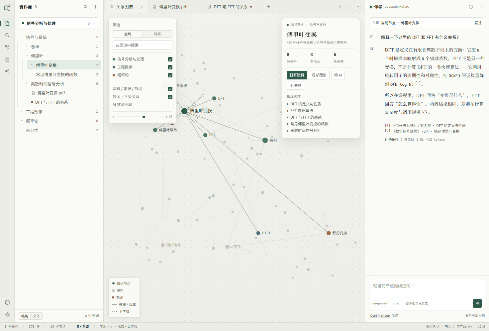
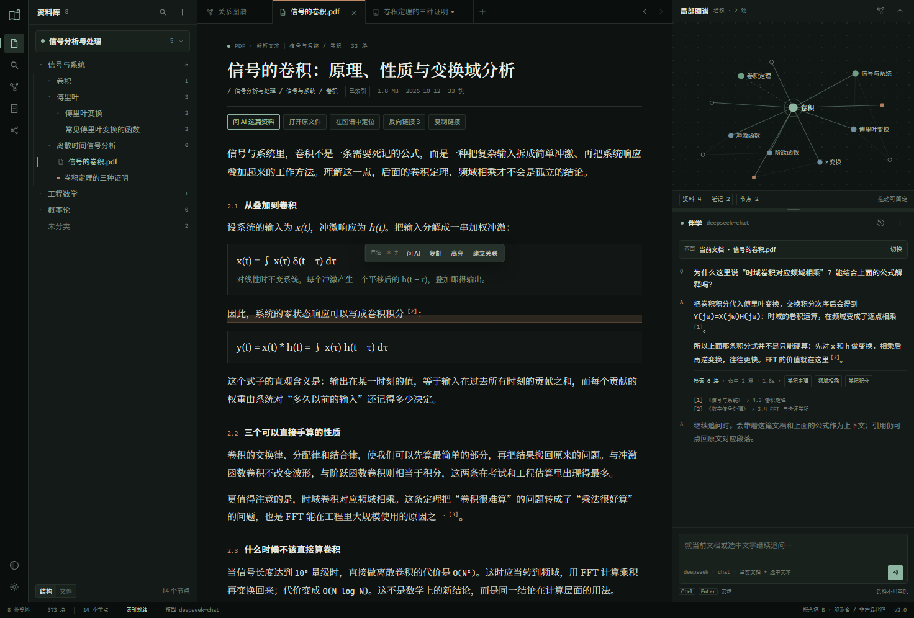

# DocLib 2.0 实施计划（已批准）

> **状态**：**用户已于 2026-11-19 批准实施**（含统一布局修订）；Phase 0 起正式开发。规划期间未修改业务代码、数据库、依赖或打包产物；仓库新增内容为 `docs/v2/`。
> **最终布局决定**：只用方案 A 的三栏结构；浅/深色仅为外观主题；右侧 AI 面板完整高度、独立空间；局部图谱只在中央标签页；不得采用方案 B 的右侧上下分栏。默认深色主题，完整浅色主题。
> **基线**：`main @157bcbe`，v1.1.2 / build 2026-11-19-r16，MIT。本机 `dist/DocLib/data` 与 `DocLib/data` 当前均不存在；真实资料库位置需在 Phase 0 以用户实际路径确认。
> **配套文档**：[ARCHITECTURE.md](ARCHITECTURE.md)（数据/API/文件级细节）、[DESIGN_SYSTEM.md](DESIGN_SYSTEM.md)（视觉/token/组件/验收）、[research/](research/)（5 份带行号或 URL 的调研报告）。
> **关于原生 Plan Mode**：本会话没有向 agent 暴露可自行切换 Plan Mode 的入口，我没有假装切换；按你要求的只读规划流程执行，批准前不会改业务代码。
> **方法与 Skills**：已加载 `ds-mode`、`ds-plan-loop`、`ds-design`；官方 `frontend-design` 本地未安装，按你的要求读取 GitHub 原文、**未安装**。Phase B 再按需加载 `ds-blueprint`、`ds-tdd`、`ds-verify-loop`、`ds-blast-radius`、`ds-review-loop`、`ds-context-reset`、`ds-ledger`。调研由 5 个只读子代理产出 `research/*.md`，主线复核源码与报告。

---

## 0. 一页结论

**推荐方案**：保留 Python/SQLite/WebView2/PyInstaller 后端，重写前端为**原生 ES Modules + 无构建**的工作区；以 **Cytoscape.js + fcose** 做真实实体图谱；新增**图谱/笔记/关系/阅读器/工作区 v2 API**；用一次**事务化、可备份、可回滚的迁移**承载新数据；**统一采用 A 三栏布局**，右侧 AI 面板完整高度；默认深色主题、完整浅色主题。

**第一版交付的闭环**：左侧树浏览 → 中央标签页打开图谱/资料/笔记 → 图谱节点跳转资料 → 选中文本向右侧 AI 提问（上下文真实生效）→ 点击引用回到原文 → 笔记双链/反链出现在图谱 → 重启恢复工作区。

**不做**：插件系统、多窗口、云同步、移动端、PDF 批注、AI 自动改写真值层、AGPL 代码复制、未经授权推送远程；**不做方案 B 的右侧局部图谱上下分栏**。

---

## 1. A. 项目现状（基于真实源码）

### 1.1 系统架构

```
DocLib.exe / run.py
  └─ doclib/web/server.py  (标准库 ThreadingHTTPServer, 127.0.0.1)
       ├─ 静态：web/static/index.html + mindmap.html（单文件、内联 CSS/JS）
       ├─ API：/api/* 旧路由 + /api/rev/*（v1.1 分区/会话/引用/资料导图）
       ├─ SQLite：data/doclib.db（WAL，FTS5 trigram，可选 sqlite-vec）
       ├─ 导入：docx/doc/pdf/pptx/md/txt/图片；Windows OCR；.doc 转 docx
       ├─ RAG：FTS/LIKE + 可选向量 + RRF；引用快照 + text_hash
       ├─ AI：OpenAI 兼容 Gateway + Ollama；DPAPI secrets；ai_runs/ai_cache
       ├─ 导出：notes.py 零依赖 OOXML（问答笔记/复习提纲）
       ├─ 导图：data/mindmaps/*.json + mindmap.html SVG 画板
       └─ 窗口：pywebview + WebView2；PyInstaller onedir；data 在 exe 同级
```

### 1.2 前端真实组织

- `index.html` 约 1.8k 行：`header`（品牌/搜索/9 个动作）+ `main` 三栏网格 `272px minmax(320px,1fr) 400px` + `footer` + 单模态 + 单 `<script>`。右栏上半是常驻 AI，下半是“内容预览”。
- `mindmap.html` 约 1.9k 行：独立页面，左工具栏 + 右侧 SVG 五层（笔迹/边/节点/词云/临时层），自由画板；数据是 `items/edges/strokes/view`，不是实体关系图。
- 状态是全局可变对象 + 十余个自由变量；52 处 `fetch`；`/api/*` 与 `/api/rev/*` 两套并行，6 处运行时三元分支。
- 设计系统只有 12 个 CSS 变量，但 51 个不同 hex、6 档圆角、278 处 px；0 处 `@media`，唯一断点是 JS `innerWidth < 1150`；窄屏 AI 直接 `display:none`，无抽屉实现（注释与代码不符）。
- 交互：树三分区拖拽、文档卡片四动作、`[n]` 引用可点、会话 pin/fav/tag/合并导出、设置大模态、splitter；无标签页、无分屏、无阅读器、无命令面板、无工作区恢复。
- 现状评价：功能闭环很强，但视觉是“2010 年代 Windows 后台工具移植风”；前端渲染/状态层已到重写点，API 契约与算法可复用。

证据：`docs/v2/research/01-frontend-audit.md`（行号引用）。

### 1.3 后端、数据与接口

- 真值层 `nodes/documents/node_documents`；派生层 `doc_chunks + chunk_fts`；审计层 `op_log`；AI 侧 `ai_providers/conversations/messages/message_citations/ai_runs/ai_cache`。
- 软删除贯彻；引用以 `doc_id + heading_path + snippet + text_hash` 快照为准，`chunk_id` 仅线索（正确设计）。
- 分区 = 一级非系统节点；`scope=all` 在带 partition 时=分区全范围，不带=全库；`tree.node_doc_ids` 做范围求解，跨分区默认拒绝。
- 问答：`/api/rev/ask` 支持 node/scope/partition/conversation_id；块级混合检索优先，文档级兜底；回答没有 `[n]` → `insufficient=true`，不伪造来源（REV-102）。
- 迁移：`db.migrate()` 顺序执行 `migrations/*.sql`，但 `executescript` 无事务、无备份、`meta.schema_version` 永远写 `"0001"`。
- API 无鉴权，安全边界=仅本机监听 + Host/Origin/Sec-Fetch-Site + JSON + 32MB + 路径/类型白名单；`X-Frame-Options: DENY` 会阻止同源 iframe。
- 静态层 `read_bytes` 无 Range、MIME 依赖 Windows 注册表、缺失资源回退 `index.html`、全局 `no-store`。
- 现有迁移/预列表：`node_associations`（node↔doc，从未写入）、`node_documents.weight/note`、`documents.cloud_allowed`、`nodes.association_on/derived_version` 均为空预留；图谱/笔记/工作区无承载表。

证据：`docs/v2/research/02-backend-data-audit.md`。

### 1.4 已有 / 可复用 / 需改造 / 缺失

| 类别 | 内容 |
|---|---|
| 直接复用 | 多格式导入、FTS5 混合检索、RAG 引用契约、分区/范围、会话隔离、多模型 Gateway、密钥 DPAPI、Word 导出、导图文件存储、备份/回收站、单实例/端口、MOTW |
| 改造后复用 | `index.html` 的 API 契约与交互语义（树拖拽、引用、会话操作）；`mindmap.html` 画板（加 embed/theme）；`server.py` 静态层与路由；`db.py` 迁移器；`rag.py` 范围与引用；`tree.py` 分区；`importer.py` 分区约束 |
| 必须新建 | 工作区壳/标签/面板/持久化；真实实体图谱（数据+API+渲染）；文档阅读器；文档/选中文本级 AI 上下文；Markdown 笔记 + 双链/反链/关系；命令面板/快速打开（P1）；分屏（P1） |
| 明确不做 | 插件系统、多窗口、云同步、移动端、PDF 批注、把 Word/PDF 原文改成可编辑 Markdown、AI 自动写真相层、复制 AGPL 代码 |

### 1.5 主要技术债与风险（按影响排序）

1. **前端单文件 + 全局状态**：无法承载多标签/分屏/多视图；重写而不是增量补丁。
2. **XSS/安全边界**：`innerHTML` 拼接、`esc()` 漏单引号、导图 JSON 回放、无 CSP；2.0 必须先立安全基线。
3. **静态层能力不足**：无 Range、MIME 不可靠、XFO DENY、404 回落 HTML，直接阻塞 PDF/iframe/vendor ESM。
4. **迁移无事务/无备份**：加新表前必须改迁移器；否则一次失败可能半迁移。
5. **打包脚本数据风险**：`move + 不校验`、`--noconfirm` 清空 dist、`_pkgdata_tmp` 未忽略；真实 `data` 可能被清空。
6. **测试空白**：importer/readers/迁移/HTTP/安全/图谱/笔记无基线；`qa_regress`/`audit` 依赖正本，当前不可复现 21/21、60/60。
7. **会话/范围语义三义**：`all` 有无 partition 不同、`node→self` 改写、messages 无范围列；2.0 用 context 显式化，旧行为保留。
8. **purge 孤儿**：`purge_node` 不做孤儿回收；加关系后必须清理，否则图谱出现悬空。
9. **导图寻址**：文件名即标题，`save` 可静默覆盖；P1 不改存储，先避免 UI 冲突。
10. **文档预览失真**：docx/pdf/pptx 解析丢排版/公式/图片；2.0 只承诺“可读、可引用、可定位”，不承诺原版还原。

### 1.6 与目标的差距

| 目标 | 现状 | 差距 |
|---|---|---|
| Obsidian 式工作区 | 三栏固定 + 单模态 | 标签、可调/可折叠、分屏（P1）、命令面板、布局恢复 |
| 真实知识图谱 | 只有树 + 自由画板 | 实体/关系模型、投影 API、力导渲染、全局/局部、筛选、联动 |
| AI 伴学 | 右栏问答，范围=node/partition | 文档/选段/笔记上下文、每轮 context、引用跳转阅读器、笔记来源 |
| 文档阅读 | 只有预览片段/打开原文件 | 完整阅读器、TOC、选区、PDF/Word/PPT 可读、引用定位 |
| 笔记/双链 | 无存储；notes.py 只是 Word 导出 | notes 表、编辑器、wikilink、反链、图谱节点、AI 存笔记 |
| 视觉 | 通用后台风 | 设计系统、深浅主题、图谱/AI/阅读的独立视觉语言、真实截图验收 |
| 数据安全 | 迁移/打包有风险 | 迁移事务+备份、打包重写、测试隔离、guard |

---

## 2. B. 开源调研结论

### 2.1 Obsidian（官方文档/API/示例插件）

值得借鉴（可迁移）：

- 工作区：Ribbon、文件资源管理器、标签页（关闭/固定/恢复）、左右侧栏折叠/调宽、分屏（左右/上下）、前进/后退、命令面板、快捷键冲突检测、右键菜单、Workspace 布局恢复。
- 图谱：全局/局部、度数决定大小、hover 高亮邻居、缩放/平移、筛选（搜索/标签/附件/孤立）、颜色组、局部深度、点击打开；**不照搬**物理滑杆、生长动画、3D、插件系统、多窗口。
- 链接：`[[笔记#标题]]`、别名、反链/出链/未链接提及；重命名更新链接；PDF 页/选区链接；Word 需自建锚点层。
- 阅读：树单击预览/双击固定、Ctrl+单击新标签、分屏、链接跳转、历史精确回位（docId+anchor+scroll）。Obsidian 的历史默认不跨重启/不精确回光标；DocLib 要做得更严格。

**推断与限制**：Obsidian 核心非开源；图谱帮助页只描述“力”的语义，不给算法/渲染/数值。我们复现交互契约，不假设其内部实现，也不复制界面。

### 2.2 Perlite / Nodum / Logseq / 思源

| 项目 | 许可 | 值得借鉴 | 不能/不该复用 |
|---|---|---|---|
| Perlite | MIT | Obsidian 元数据 JSON → 图投影 + 缓存；全局/局部；孤儿过滤 | PHP + vis-network 栈；无数据库；无工作区 |
| Nodum | MIT | Markdown 为真值；wikilink/别名；未解析链接用 ghost 节点；WebGL 力导；插件沙箱 | Next+Postgres+Redis+MinIO，不是单机本地库；代码栈差异大 |
| Logseq | AGPL-3.0 | 文件优先 + 派生索引；page/block 双粒度；block ref；插件模型 | **AGPL 代码不能复制进 MIT 项目**；Pixi 图谱仍 pre-release |
| 思源 | AGPL-3.0 | 服务端构图（SQL→graph）、BFS 深度、节点上限、Worker 分片、WebGL/Canvas 双路径、标签过滤 | **AGPL 代码不能复制**；`.sy` JSON + Go kernel 与 DocLib 不同 |

结论：只借鉴架构与交互契约，不复制 AGPL/LGPL 代码；MIT 组件若直接复用保留版权声明。

### 2.3 图谱库选型

| 库 | 许可 | 体积（min+gzip） | 优势 | 风险 |
|---|---|---|---|---|
| **Cytoscape.js 3.35 + fcose 2.2** | MIT / MIT | ≈139KB（Cytoscape）+ fcose | API 完整：选择器、邻域、BFS、筛选、标签、布局、固定节点；Canvas 默认稳；WebView2 友好 | 5k 节点需限流；fcose 久未更新，需锁版本 |
| Sigma.js 4 + graphology | MIT | ≈110KB | WebGL2 吞吐/SDF 标签，大图潜力 | WebGL2-only 无 Canvas 兜底；拖拽/邻居/局部/筛选要自己组合 |
| d3-force 自绘 | ISC | ≈5.8KB（仅布局） | 完全可控、体积小 | 交互/渲染/命中/标签全部自写；5k 必须 Worker |
| 现有 DocLib SVG | MIT | 84KB 文件 | 零依赖、画板成熟 | 全量 innerHTML 重建；不是图谱；1k+ 不可行 |

**决定：Cytoscape.js 3.35 + fcose 2.2 做第一版**；Canvas 渲染，WebGL 预览先不开；全局默认 1500 节点，局部图 ≤800；5k 数据只做局部/筛选。Sigma 作为“5k 硬指标 + WebGL2 可靠”时的备选。手工导图 `mindmap.html` 保留，独立渲染，不做双写。

### 2.4 可直接复用 / 借鉴架构 / 自主实现

- **可直接复用（组件/库）**：Cytoscape.js、fcose、marked、DOMPurify、CodeMirror 5、Lucide 图标子集（均为 MIT/Apache-2.0/ISC/OFL 兼容许可）；Python 侧无新原生依赖。
- **借鉴架构**：Obsidian 的命令注册表/布局恢复/图谱交互契约；思源的服务端投影 + 节点上限 + Worker；Perlite 的元数据→图投影；Nodum 的 ghost 节点/未解析链接（DocLib P1 只做“未解析”提示，不自动建空实体）。
- **必须自主实现**：SQLite 实体/关系模型、分区隔离、文档/选段上下文、引用快照扩展、笔记双链解析、阅读器定位、工作区持久化、数据迁移/打包安全。

---

## 3. C. UI/UX 方案（最终批准版）

详见 [DESIGN_SYSTEM.md](DESIGN_SYSTEM.md)。

### 3.1 唯一工作区布局（A）



- 左：Ribbon + 资料库树（学科分类、节点、资料、笔记、搜索、图谱入口）。
- 中：多标签工作区（全局图谱、局部图谱、PDF/Word/PPT 阅读、Markdown 笔记、现有导图、搜索结果、节点概览）。
- 右：AI 伴学，**完整右侧高度、默认 374px、可调宽/折叠**；头部 → 可滚动对话 → 固定输入区。
- 下：26px 状态条。
- 文档、笔记、全局图谱、局部图谱都在中央标签页切换；局部图谱不占 AI 面板。

### 3.2 深色主题（默认）与浅色主题



- 深色为**默认主题**；浅色为完整替代。两者只改颜色/字体色/边框/图标色/强调色/图谱表现/阴影；**布局、面板尺寸、标签位置、AI 结构完全不变**。
- 方案 B 的右侧“局部图谱 + 伴学”上下分栏**明确否决**；图中仅参考其墨绿黑、鼠尾草绿、赭石、细线结构。
- 三条不变量：
  1. 浅/深色不是两套布局；
  2. 文件、笔记、全局图谱、局部图谱全在中央标签页；
  3. AI 面板始终完整高度、独立空间，不得被局部图谱/预览挤占。

### 3.3 设计系统要点

- 字体：UI `Noto Sans SC` / `Microsoft YaHei UI`；阅读 `Noto Serif SC`；元数据 `Cascadia Mono`。本机已装 Noto Sans/Serif SC，v2.0 不打包字体（P2 可选 OFL 子集）。
- 色：浅色 `#F2F2EC / #1F2420 / #2E5A4A / #8A5A44`；深色 `#0F1512 / #E5E7DF / #8FB6A2 / #C18A67`；学科色 6 组，均低饱和。
- 布局：Ribbon 44 + 左栏 268（220–360）+ 中央（min 520）+ AI 374（320–480）+ 状态 26；标签 40；树行 28；阅读列 ≤760。
- 圆角 2/4/8；间距 4px 基数；阴影只用于浮层；无渐变/发光/玻璃拟态。
- 动效 90–160ms，服务反馈；`prefers-reduced-motion` 关闭；无逐卡片入场。
- 图标一套 Lucide 子集；不用 emoji 当图标。
- 状态：hover/focus/active/disabled/loading/skeleton/empty/error/offline/模型未配置/资料不足/源文件丢失/保存冲突。
- 响应式：1440/1920/1100/920；无横向滚动；窄屏 AI 以抽屉/sheet 可达，不再 `display:none`。
- 视觉验收：8 张截图矩阵（浅/深、1440/1920/1100/920、图谱/阅读/笔记/空态），`ds-design-audit` 评分并修复后重截；同一场景浅/深布局尺寸必须一致。

---

## 4. D. 技术架构（决策摘要）

详见 [ARCHITECTURE.md](ARCHITECTURE.md)。

| 决策 | 选择 | 主要替代 | 理由 |
|---|---|---|---|
| 前端 | 原生 ES Modules + 无构建；view/store/命令注册表 | Vite + Vue/Preact | 不把 Node 构建链带入 PyInstaller/离线；单窗口复杂度可控 |
| 图谱 | Cytoscape.js 3.35 + fcose 2.2，本地 vendor | Sigma 4、d3-force 自绘 | 交互/布局/筛选 API 最完整，Canvas 对 WebView2 最稳 |
| 工作区 | `data/workspace.json` 原子读写 + 校验 + 备份 | localStorage、SQLite 表 | 端口/换机不丢；不占迁移；易备份 |
| 笔记 | SQLite `notes/note_chunks/note_fts/note_links` | 文件式 `data/notes/*.md` | 与备份/检索/引用/图谱同源；冲突/权限简单 |
| 关系 | `relations` 多态表 + `note_links` | 复用 `node_associations` | 旧表是 node↔doc 且未用；新表支持 node/doc/note、origin/confidence |
| 迁移 | 0006 图谱/上下文/引用；0007 笔记/双链；事务+备份 | 直接改库/一次大迁移 | 可回滚、可分阶段验证 |
| API | 旧路由保留；新功能 `/api/v2/*`；`/api/rev/ask` 加 context | 全部重写 `/api/v2` | 旧测试/旧前端兼容；新代码不再双分支 |
| 阅读器 | Markdown 原文渲染；PDF 内嵌 + 解析文本备用；Office 解析块 | PDF.js 全量、Office 在线预览 | 本地/离线；不承诺原版排版；PDF.js 作为 P1 备选 |
| AI 上下文 | `context{kind,partition,node,doc,note,chunk,quote}`；文档/选段只检索该文档；选文作为首条来源 | 仅前端标签、后端仍全库 | 上下文真实生效、可复现、可测试 |
| 笔记入 RAG | note_fts + 笔记通道；新 UI 默认包含，旧 API 默认不含 | 只检索文档 | 避免旧回归；逐步扩展 |
| 打包 | 保留 PyInstaller onedir；重写 `打包.bat` 数据保护；无 Node | 换 Electron/Tauri | 保留现有交付形态与体积 |
| WebView2 | 声明 Chromium ≥117；本机 157 | 兼容旧内核 | ESM/`dvh`/Highlight API 等；旧机提示升级 |

### 4.1 数据模型（新增）

- `relations(id, src_kind, src_id, dst_kind, dst_id, rel, label, origin, confidence, evidence_json, created_at, updated_at, deleted_at)`；唯一键 `(src,dst,rel,origin)` 软删条件；人工/AI 分离。
- `notes(id,title,body_md,node_id,partition_id,created_at,updated_at,deleted_at)`；标题全局唯一（`COLLATE NOCASE`，软删条件）。
- `note_chunks` + `note_fts`（trigram）；`note_links`（目标、标题、heading、alias、offsets、resolved）。
- `messages.context_json`、`conversations.context_json`；`message_citations` 增加 `source_kind/note_id/doc_title/page/start_off/end_off/quote`；`doc_chunks` 增加 `page/start_off/end_off`。
- 不复制树/挂载到 relations；图谱 API 联查，避免双写。

### 4.2 图谱 API / 渲染

- `GET /api/v2/graph?scope=global|partition|local&partition&center&depth&types&rels&q&limit`。
- 实体 `node/document/note`；边 `hierarchy/mount/manual/ai/wikilink`；ID 命名空间；度数在子图内计算；`truncated` 明示。
- 全局默认 1500（可 2000）；局部 ≤800；AI 边默认不返回。
- Cytoscape：Canvas、fcose、拖动固定、缩放/平移、邻居高亮、单击选中、双击打开、右键、筛选、搜索、固定位置持久化、重置布局。
- 性能门槛：1k/3k 首次可交互 ≤1.5s；5k 若 <15 FPS 则全局限量 + 局部图；原型数据 1k/5k 对照（见 research/05）。

### 4.3 阅读器

- `GET /api/v2/reader/<doc_id>` 分页 chunk + TOC + doc meta；`GET /api/v2/file/<doc_id>` Range/inline/MIME 白名单；`GET /api/v2/raw/<doc_id>` md/txt。
- Markdown 原文渲染（marked + DOMPurify）；PDF iframe 内置；Office 解析块；图片 + OCR 文本。
- 引用定位：chunk 锚点 + Highlight API；PDF 有 page 则“第 N 页”；选文工具条 → AI。
- 文件流只按 doc_id 解析路径，不接受任意路径；缺失/解析失败有明确状态。

### 4.4 AI 上下文

- `context.kind = partition | node | document | selection | note`；document/selection 只检索该文档，不扩大到全库；selection 把选文作为首条来源（引用 [1] 才算使用）。
- `qa_v4.txt` 提示词；`PROMPT_VERSION=4`；缓存键含上下文摘要/Prompt 版本。
- 每轮 `messages.context_json`；conversation 记最近上下文；切换写 `op_log`；历史消息不追改。
- 引用快照扩展；无 `[n]` = 资料不足；不伪造来源；笔记来源可点击打开笔记。
- 旧 `/api/ask` 行为不变；旧 `/api/rev/ask` 不带 context 行为不变。

### 4.5 笔记与双链

- 笔记存 DB；标题唯一；分区必填；`[[note:12|标题]]`/`[[doc:34|标题]]`/`[[node:7|标题]]` 稳定形式；`[[标题]]` 按唯一标题解析，歧义不自动选。
- 保存事务：note → chunks/FTS → links；未解析不自动建空笔记；反链分已链接/未解析。
- 编辑器 CodeMirror 5；预览 DOMPurify；自动保存 + 冲突对话框；AI 回答“存为笔记”。
- 图谱出现笔记节点/双链边；AI 可用笔记作为来源（P0 基础，P1 扩展未链接提及/别名）。

### 4.6 静态层、安全、打包

- MIME 表、404 不回落、Range、SAMEORIGIN、CSP、缓存策略、错误脱敏；新增 HTTP 测试。
- 迁移：先备份、事务、失败回滚、`schema_version` 修正；测试注入失败。
- 打包：先备份并校验、构建到临时目录、成功后合并；`_pkgdata_tmp` 入 `.gitignore`；干净包去 secrets；补齐 `解除锁定.bat`/说明；不推送。
- 许可：Cytoscape/fcose/marked/DOMPurify/CodeMirror/Lucide 写入 `THIRD_PARTY_NOTICES.md`；不复制 AGPL 代码；README 的“未声明许可”改为与 LICENSE（MIT）一致。

---

## 5. E. 文件级阶段计划

> 时间以“可验收的工作日”估算，不是日历承诺；每阶段结束都可交付/回滚。每步的 acceptance 是硬门槛，未过不进入下一步。

### Phase 0：安全基线（1 天）

**任务**
- 从 `main` 建 `v2.0-dev` 分支；打本地 tag `v1.1.2-baseline`（不推送）。
- 建 `docs/v2/PROGRESS.md`（阶段/改动/测试/决策/下一步）、`docs/v2/DECISIONS.md`（ds-ledger 风格，一行一决策）。
- 环境：Python 3.11 venv；装 `requirements.txt` + `pywebview/pythonnet`；确认 WebView2；记录版本。
- 定位真实数据：打印 `config.DATA_DIR`；若存在真实库，**只读**；建立 `DOCLIB_DATA` 临时测试目录；不运行会写正本的测试。
- 写 `scripts/v2_guard.py`：检查 `DOCLIB_DATA`、拒绝在真实 `dist/DocLib/data` 上跑破坏性测试/打包；打印安全摘要。
- 跑可跑基线：`smoke`、`test_scope_isolation`、`test_partitions`、`test_citations`、`test_mindmap_gen`；记录结果。`qa_regress`/`audit` 需 fixture，Phase 0 只记录“待建 fixture”，不伪造 21/21、60/60。
- 修 `.gitignore`（`_pkgdata_tmp`、`.venv`、测试产物），不改业务逻辑。

**文件**：`docs/v2/PROGRESS.md`、`docs/v2/DECISIONS.md`、`scripts/v2_guard.py`、`.gitignore`。
**验收**：分支/tag 存在；5 个基线测试真实通过；真实 data 零写入；guard 能阻止误跑；基线写入 PROGRESS.md。
**风险/回退**：依赖安装失败 → 只跑无依赖测试，窗口验证推迟；不阻塞前端/后端编码。回退：删除分支即可（不改 main）。

### Phase 1：静态层 + 工作区壳 + 设计系统（4–5 天）

**任务**
- 静态层：MIME 表、404、Range、XFO SAMEORIGIN、CSP、缓存；HTTP 测试。
- 设计 token：`styles/tokens.css` 浅/深；字体栈；间距/圆角/阴影；主题切换（system/light/dark）。
- 壳：Ribbon、Explorer（分区/树/资料叶/笔记叶/结构-文件）、TabStrip、AI 侧栏骨架、状态条、可折叠/拖宽、响应式（1440/1920/1100/920）。
- 工作区：`workspace.js` + `/api/v2/workspace` 原子读写/校验/恢复；旧 localStorage 迁移；默认布局；损坏回退。
- 命令注册表 + 基础快捷键（Ctrl+S、Ctrl+W、Ctrl+Tab、Esc）；统一 dialog/menu/toast；去除 `prompt/confirm`。
- 视图骨架：欢迎/空库、节点概览、搜索占位、设置标签、阅读占位、图谱占位；导图 tab 用 iframe `?embed=1`，标题/脏状态 postMessage。
- 保留旧功能入口：导入、搜索、AI、备份、回收站、模型设置、Word 导出；API 用 `/api/rev/*`。
- 真实截图：1440/1920、浅/深；先做一次视觉自审。

**文件**：`web/static/index.html`（壳）、`app/**`、`styles/**`、`vendor/icons.svg`、`web/static/mindmap.html`（embed/theme）、`doclib/web/server.py`（静态层/路由入口）、`doclib/web/workspace.py`、`api_v2.py`（workspace）、`tests/test_http_v2.py`、`tests/test_workspace.py`。
**验收**：三栏壳真实可交互；树/标签/面板/主题/布局恢复；旧功能可打开；920 无横向滚动、AI 可呼出；HTTP 安全/Range 测试通过；截图留存。
**风险/回退**：重写导致旧功能丢失 → 每个旧入口有 checklist + 真实点击；保留旧 `index.html` 在 git 历史，必要时 `git show` 回退；不合并未验收的壳。

### Phase 2：迁移安全 + 图谱（5–6 天）

**任务**
- 改 `db.migrate`：备份、事务、失败回滚、`schema_version`；测试注入失败。
- 0006：relations/messages.context/citations/doc_chunks 新列；测试旧库升级。
- `graph.py`：实体/边投影、global/partition/local、深度、类型/关系/搜索过滤、limit/truncated、度数。
- API `/api/v2/graph`；关系 CRUD 基础（创建/删除 manual）；树/分区元数据。
- 前端：Cytoscape vendor、`graph.js`、`style.js`、`filters.js`、`inspector.js`；全局/局部、拖动固定、缩放/平移、hover 邻居、单击/双击、右键、搜索、fit/reset、位置持久化。
- 树↔图谱联动；节点概览标签；图谱空态/加载/错误/截断。
- 原型门槛：1k/3k 合成数据（中文标签）；5k 对照；测 API/布局/帧率/内存；不达标则降级（全局 1000 + 局部 600）。
- 修 `purge` 孤儿/关系清理；测试。

**文件**：`migrations/0006...`、`db.py`、`graph.py`、`api_v2.py`、`server.py`、`app/views/graph.js`、`app/graph/**`、`vendor/cytoscape*`、`tests/test_migrations_v2.py`、`tests/test_graph.py`、`tests/test_graph_perf.py`。
**验收**：旧库升级数据不丢；迁移失败可回滚；图谱全局/局部/筛选/联动真实可用；1k 门槛达标；5k 有明确降级；截图 1440/1920 浅/深。
**风险/回退**：Cytoscape 5k 性能不足 → 限流/局部图；迁移失败 → 备份恢复；图谱影响阅读 → 默认打开“全局图”标签但可关闭，不占常驻空间。

### Phase 3：阅读器 + AI 伴学（5–6 天）

**任务**
- 静态/Range 已就绪；`reader.py`：分页/TOC/around、md/txt raw、PDF file、图片。
- PDF spike：WebView2 内嵌 `#page=N`；成功→保留；失败→解析文本 + “打开原文件”，P1 评估 PDF.js。
- 前端 Reader：文档头、TOC、正文、chunk 锚点、选区工具条、引用高亮、打开原文件、问 AI、源文件缺失/解析失败。
- AI：context 条（分区/节点/文档/选文/笔记）、请求体 `context`、消息 context 标记、来源/检索轨迹、错误/资料不足、长会话滚动、历史/新对话/模型切换。
- 后端：`rag.ask` context 解析、选文首条来源、prompt v4、缓存键；`messages/conversations.context_json`；citations 扩展；统一 conv detail 回读。
- 引用跳转：点击 `[n]` → 打开/聚焦文档标签 → chunk 高亮；PDF 页号（有则）。
- 测试：`test_context.py`、`test_reader.py`、真实 HTTP；旧 ask 回归。
- 截图：阅读+选区+引用、AI 多轮、资料不足、错误。

**文件**：`reader.py`、`context.py`、`rag.py`、`citations.py`、`server.py`、`api_v2.py`、`app/views/reader.js`、`app/ai/**`、`prompts/qa_v4.txt`、tests。
**验收**：5 条流程中的“AI 伴学”真实通过；文档/选段检索只在本范围；引用可回原文；资料不足不伪造；旧 `/api/ask` 不变。
**风险/回退**：PDF 内嵌失败 → 解析文本 + 原文件；context 检索错误 → 范围测试/引用测试；prompt 质量回退 → 保留 qa_v3 可切回（prompt 版本化）。

### Phase 4：笔记、双链、工作区增强（5–6 天）

**任务**
- 0007 notes/note_chunks/note_fts/note_links；测试旧库升级/幂等。
- `notebook.py`：CRUD、标题唯一、分区校验、Markdown 分块、FTS、保存冲突、恢复/清除。
- `links.py`：wikilink 解析（稳定 ID/标题/heading/alias/代码块排除）、解析/未解析、反链、关系 CRUD。
- 前端 NoteEditor（CodeMirror 5）+ 预览 + 双链补全 + 反链面板 + 自动保存/冲突；AI“存为笔记”；笔记进树/图谱。
- 笔记入 RAG（note_fts + 笔记通道；新 UI 默认包含，旧 API 默认不含）；引用来源 note。
- P1：命令面板/快速打开、搜索标签、导航历史/Alt+←→、分屏两窗格、标签拖拽/固定、未链接提及、别名、笔记重命名自动更新、检索轨迹展开、AI 存为笔记（基础版 P0）、PDF.js（若原生失败）。**不做局部图谱侧栏。**
- 测试：`test_notebook.py`、`test_context.py` 扩展、`test_workspace.py` 扩展、E2E 流程四。
- 截图：笔记编辑/双链/反链、图谱含笔记、分屏（若做）。

**文件**：`migrations/0007...`、`notebook.py`、`links.py`、`search.py`、`rag.py`、`app/views/note.js`、`app/views/search.js`、`app/workspace/**`、`vendor/codemirror5/**`、tests。
**验收**：创建笔记→`[[...]]`→反链→图谱出现笔记/边；重命名不断链（稳定 ID）；AI 存笔记；旧功能不回归。
**风险/回退**：XSS/链接误解析 → DOMPurify + 解析测试 + 编辑预览隔离；笔记范围污染 → 分区/scope 测试；CodeMirror 集成风险 → 退化为增强 textarea（功能不变）。

### Phase 5：质量与视觉精修（5–7 天）

**任务**
- 测试：全量旧测试 + 新增；`qa_regress`/`audit` 用 fixture 可复现；`audit_doclib` 增至 ≥70 项；HTTP 真请求；迁移失败；引用；图谱 1k/5k；笔记 XSS；Range/路径；工作区损坏。
- E2E（Playwright + Edge channel，dev 依赖）：5 条流程 + 截图；WebView2 原生窗口跑一遍；窄窗/主题。
- 视觉：按 DESIGN_SYSTEM 8 张矩阵截图；`ds-design-audit`；修复后重截；对比度/焦点/键盘/空态/错误。
- 性能：图谱、树、长会话、阅读分页；API p95；内存。
- 安全：CSP、XSS payload、路径、Host/Origin、错误脱敏、密钥不回显。
- 打包 dry-run：新打包逻辑在临时目录验证，确认 data 不丢；不进真实 dist。
- 回归 checklist：导入/搜索/AI/导图/Word 导出/模型/回收站/备份/恢复。

**文件**：tests/**、`scripts/audit_doclib.py`、`docs/v2/TEST_REPORT.md`、`docs/v2/SCREENSHOTS/`、`打包.bat`（重写，Phase 6 正式用）。
**验收**：所有测试真实通过；5 条流程通过；视觉审计问题修复；WebView2 可运行；数据安全 checklist 全绿。
**风险/回退**：环境/依赖问题 → Phase 0 已装；视觉不达标 → 按审计逐条修，必要时缩小动效/装饰；性能不达标 → 限流/虚拟化；无法在时限内达标 → 明确列出 P1/P2 延后，不假装完成。

### Phase 6：交付（1–2 天）

**任务**
- 修 `打包.bat`：程序占用检查、备份校验、构建到临时 dist、成功后合并、失败中止；`_pkgdata_tmp` 忽略；干净包不含 secrets/个人 data；补 `解除锁定.bat`/使用说明；版本号/CHANGELOG/README（MIT 一致）。
- 本地构建 `dist/DocLib`；在干净临时数据目录启动验证；跑 5 条流程；截图。
- 生成交付文档：`IMPLEMENTATION_PLAN.md`（本文件）、`ARCHITECTURE.md`、`DESIGN_SYSTEM.md`、`PROGRESS.md`、`TEST_REPORT.md`、`KNOWN_LIMITS.md`。
- 本地 tag `v2.0.0`；**不 push**；把构建/截图/测试报告交给你。

**验收**：exe 启动；数据保留；干净包无密钥/个人资料；5 条流程；文档齐全；可回滚到 v1.1.2。
**风险/回退**：打包失败 → 保留源码/旧 dist；数据风险 → 只操作备份副本；不覆盖用户真实 data。

---

## 6. F. 优先级与交付范围

### P0（第一版必须有，缺一不算 2.0）

- 工作区：Ribbon/树/标签/三栏/折叠/调宽/深浅主题/布局恢复；AI 始终可达；920 窄窗。
- 图谱：实体/关系模型、迁移、API、全局/局部、力导、拖动/缩放/平移、选中/双击、hover 邻居、学科/类型/关系筛选、搜索、信息面板、树联动、截断/性能上限。
- 阅读器：标题/元信息/TOC/正文/选区/复制/搜索/问 AI/打开原文件/引用定位；md/txt/pdf/word/ppt 可读（允许 Office 解析文本）。
- AI：多模型/新对话/历史/多轮/分区/节点/文档/选文上下文/引用/资料不足/错误/加载/长会话滚动；旧导出保留。
- 笔记：创建/保存/唯一标题/分区/`[[...]]`/反链/图谱节点/AI 存笔记；基础关系 CRUD。
- 旧功能：导入/搜索/问答/导图/Word 导出/模型/回收站/备份/恢复。
- 数据：迁移事务+备份；旧库兼容；删除关联清理；测试隔离。
- 安全/静态：CSP/XSS/路径/Range/MIME/404。
- 质量：5 条流程、测试、视觉截图。

### P1（优先增强，P0 稳定后）

- 分屏（左右；拖拽/比例/恢复）；标签拖拽排序/固定/恢复关闭；命令面板/快速打开；导航历史；未链接提及/别名/笔记重命名自动更新；搜索笔记；PDF.js（若原生失败）；标签预设布局；快捷键自定义；设置导入导出；图片/公式预览增强。**分屏只作用于中央工作区，不改变右侧 AI 面板。**

### P2（后续）

- AI 推测关系（人工确认后入图）、笔记语义检索、流式回答（SSE）、多窗口、插件 API、云同步/移动端、PDF 批注、高级图算法（社区发现/路径）、Office 原版排版。

### 明确不做

- 不做插件市场/第三方脚本执行；不做多人协作/账号；不做把资料原文改成 Markdown；不做未经授权的远程推送；不复制 AGPL 代码。

---

## 7. 验收

### 7.1 五条用户流程（真实运行，不靠推断）

1. **图谱学习**：打开 → 选课程 → 全局图谱 → 点击知识节点 → 局部关系 → 双击/打开资料 → 回退。
2. **AI 伴学**：打开 PDF/Word → 选中文本 → 右侧提问 → 后端只在该文档/选段检索 → 回答带引用 → 点引用回原文高亮。
3. **工作区管理**：同时打开文档、图谱、笔记 → 切标签 → 调面板宽度 → 重启 → 恢复布局/活动标签/滚动。
4. **笔记与关联**：新建笔记 → `[[文档/笔记/节点]]` → 反链可见 → 图谱出现笔记节点与连线 → 重启仍在。
5. **旧功能回归**：导入、搜索、AI 问答、知识导图、Word 导出、模型配置、回收站、备份全部可用。

### 7.2 测试命令（Phase 0 建立可复现基线）

```bat
:: 无第三方依赖，当前可跑
python tests\smoke.py
python tests\test_scope_isolation.py
python tests\test_partitions.py
python tests\test_citations.py
python tests\test_mindmap_gen.py

:: Phase 0/5 新增
python tests\test_migrations_v2.py
python tests\test_graph.py
python tests\test_notebook.py
python tests\test_context.py
python tests\test_workspace.py
python tests\test_reader.py
python tests\test_http_v2.py
python tests\test_graph_perf.py

:: fixture 库（不碰正本）
set DOCLIB_DATA=%TEMP%\doclib-fixture
python tests\qa_regress.py
python scripts\audit_doclib.py
```

- 当前基线事实：5 个无依赖测试在本机通过；`qa_regress`/`audit`/`test_notes` 依赖正本或 dist 数据，**现在不能复现 21/21、60/60**；Phase 0 建合成 fixture 后再给出真实数字。`audit_doclib` 实际约 62 个检查点，README 的 60 需更新；2.0 目标 ≥70。
- 所有测试必须 `DOCLIB_DATA=临时目录`；测试结束清理；guard 拦截真实 data。
- 结果写入 `docs/v2/TEST_REPORT.md`（命令、exit code、摘要、失败原因）。

### 7.3 视觉验收

- 8 张截图矩阵（见 DESIGN_SYSTEM §7），必须真实渲染；至少 1440×900 浅/深、1920×1080、1100/920 窄窗、图谱/阅读/笔记/空态。
- `ds-design-audit` 评分 + 逐条修复；对比度抽查；焦点可见；无横向滚动；无永久遮挡。
- 只有源码/概念稿、没有真实页面截图，不算完成 UI 验收。

### 7.4 性能与安全门槛

- 图谱：1k/3k 首次可交互 ≤1.5s；平移/缩放 ≥45 FPS（目标机 WebView2）；5k 若 <15 FPS 则限流/局部图；局部深度 2 ≤300ms；邻居高亮 ≤100ms。
- 页面：冷启动首屏 ≤1.5s（本地）；树 10k 节点可滚动；长会话只渲染最近 50 条；阅读分页 ≤200 块/次。
- 迁移：旧库升级后行数/文档/会话/引用一致；失败回滚；备份存在。
- 安全：CSP 生效；Markdown XSS payload 不执行；路径/Range/Host/Origin 测试通过；错误不含路径/密钥；打包包无 secrets/个人 data。

---

## 8. G. 风险与保护

| 风险 | 等级 | 触发 | 保护/回退 |
|---|---|---|---|
| 真实资料库被测试/迁移/打包破坏 | 高 | 误用真实 `data`、迁移失败、打包清空 | Phase 0 guard；所有测试临时库；迁移前备份；打包重写；只操作副本；失败停止 |
| 前端重写丢失旧功能 | 高 | 入口遗漏、API 契约变化 | 旧路由保留；旧入口 checklist；分阶段合并；git 分支/tag；真实点击回归 |
| 迁移半执行/数据不一致 | 高 | 多条 DDL 中途中止 | 事务+备份+注入失败测试；失败不启动/只读提示；恢复备份 |
| 图谱 5k 性能不足 | 中 | 真实库很大/集显 | 1500/800 上限；局部图优先；Cytoscape Canvas；Sigma 备选；明示截断 |
| WebView2 不支持内嵌 PDF | 中 | 实测失败 | 解析文本 + 打开原文件；P1 PDF.js（MIT）；不阻塞主流程 |
| AI 上下文/引用错误 | 中 | 文档/选段范围错、缓存串 | 范围测试/引用测试；上下文入缓存键；prompt 版本化；保留旧行为 |
| 笔记 XSS/链接误解析 | 中 | 恶意 Markdown、同名实体 | DOMPurify；textContent；CSP；稳定 ID；歧义不自动选；测试 payload |
| 打包/分发出问题 | 高 | data 移动失败、缺 WebView2 | 新打包流程；干净包验证；WebView2 检测/说明；不推送 |
| 视觉返工/模板感 | 中 | 只“能用”、未截图 | 统一布局 tokens + 概念稿；Phase 1 真截图；Phase 5 审计修复；浅/深同布局检查 |
| 范围膨胀 | 中 | P1/P2 混入 P0 | P0/P1/P2 清单；每阶段验收；不做清单 |
| 依赖/环境不可用 | 中 | pip/网络/WebView2 缺 | Phase 0 记录；无依赖测试兜底；窗口验证可延后但有替代 |
| 许可风险 | 低 | 复制 AGPL/来源不明代码 | 只用 MIT/Apache/ISC/OFL；NOTICE；不复制 Logseq/思源代码 |
| 真实用户偏好与设计不符 | 中 | 用户更喜欢 B/深色 | A 为默认，B 暗色主题；可在 Phase 1 后按截图调整，不推翻架构 |

**数据保护红线**

- 不删除/清空用户 `data`、数据库、密钥、配置。
- 不对真实库跑迁移测试/破坏性测试；不在真实 `dist/DocLib/data` 上跑 `tests`/`audit`。
- 打包前验证进程关闭、备份成功、move/copy 成功；失败中止。
- 不 `git push`、不 force push、不覆盖远程；本地 tag 由用户决定。
- 不修改无关项目；只在 `E:\user351282\知序\DocLib` 工作。

---

## 9. 时间与里程碑（估算）

| 里程碑 | 阶段 | 估算 | 可验收产物 |
|---|---|---|---|
| M0 | Phase 0 | 1 天 | 分支/tag、基线、guard、PROGRESS |
| M1 | Phase 1 | 4–5 天 | 工作区壳/主题/布局恢复/静态层 + 截图 |
| M2 | Phase 2 | 5–6 天 | 迁移 0006、图谱全局/局部/筛选/联动 + 性能报告 |
| M3 | Phase 3 | 5–6 天 | 阅读器、AI 上下文/引用/资料不足 + 流程二 |
| M4 | Phase 4 | 5–6 天 | 笔记/双链/反链/关系/图谱笔记 + 流程四 |
| M5 | Phase 5 | 5–7 天 | 全量测试、视觉审计、WebView2、打包 dry-run |
| M6 | Phase 6 | 1–2 天 | 本地构建、干净包、文档、截图、tag |

合计约 **26–33 个工作日**（不含你审阅/反馈等待）。P1 若全做，另加约 3–5 天；我会在 Phase 4 前给出取舍建议。

---

## 10. 已批准的决定与实施约束

**2026-11-19 用户已批准：**

1. **视觉/布局**：统一采用 A 三栏；右侧 AI 面板完整高度、独立空间、默认 374px；局部图谱只在中央标签页；**禁止 B 的右侧上下分栏**。浅/深只是主题，默认深色、完整浅色。
2. **笔记**：SQLite `notes/note_chunks/note_fts/note_links`，支持 Markdown 导入导出。
3. **PDF**：WebView2 原生内嵌 + 解析文本备用；失败再评估 PDF.js（P1）。
4. **分屏**：P0 多标签 + 可调三栏 + 布局恢复；左右分屏 P1，且只影响中央工作区。
5. **交付**：本地构建 + 干净 Windows ZIP；不推送远程。
6. **数据位置**：Phase 0 只读定位真实资料库；若在其他路径（`dist\DocLib\data`/U 盘），只做备份，不写入。

**开发不变量**：浅/深同布局；文件/笔记/全局图谱/局部图谱都在中央标签；AI 面板不被挤占、不因标签切换变形；旧功能与旧 API 保留；所有测试用临时 `DOCLIB_DATA`；不 push。

---

## 11. 批准后的第一步（不会跳过）

1. 建 `v2.0-dev`，写 PROGRESS/DECISIONS，跑基线，定位真实数据（只读）。
2. 按 Phase 1 先做静态层与工作区壳；每完成一小步跑真实验证并记录。
3. 每个 Phase 结束给你一份：改动文件、测试命令/结果、截图、未解决问题、下一步；你可在任意阶段叫停/改向。
4. 不 push、不打包真实 data、不改无关项目。

**方案已批准；Phase 0 开始。**
