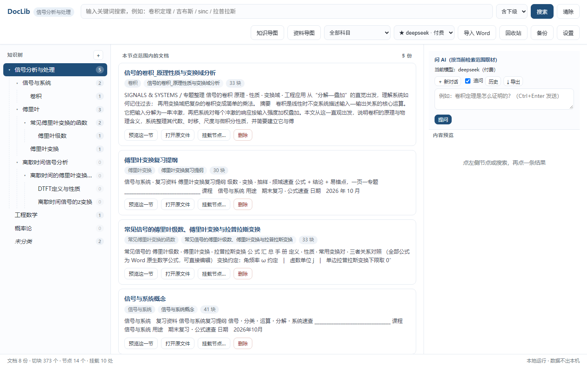
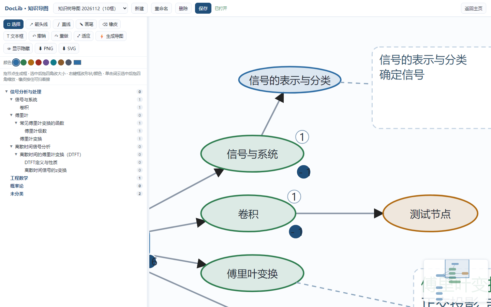

# DocLib v1.1.0 新功能一览

> 版本：**v1.1.0** ｜ 构建：**2026-11-18-r15** ｜ 发布：[GitHub Release v1.1.0](https://github.com/owen-4-R/DocLib/releases/tag/v1.1.0)
> 定位不变：纯本地、单机、数据不出本机；新增的都是"复习场景"里真正会用到的能力。



---

## 1. 科目分区：一个程序管多门课

**问题**：以前只有一棵知识树，所有课程混在一起；搜"傅里叶"可能翻出别的课的资料。

**现在**：一级节点就是"科目分区"（如「信号分析与处理」「工程数学」「概率论」），顶栏下拉可切换。

- 切换分区后：左侧知识树、文档列表、搜索结果、AI 问答**全部按该分区过滤**
- 默认「全部科目」保持旧行为，不影响老用户
- 导入时可限定在目标分区内，挂到区外的文档会自动收回分区根


**新接口**（只新增，不改旧路由）：

```
GET  /api/rev/partitions
GET  /api/rev/tree?partition=<id>
GET  /api/rev/docs?partition=<id>&node=<id>&scope=self|subtree|all
GET  /api/rev/search?q=...&partition=<id>
POST /api/rev/ask
POST /api/rev/import
```

---

## 2. 会话隔离：不串历史、不串范围

**问题**：旧实现按"标题前 24 字"查找会话，两个不同分区、开头相同的问题会被合并成一个会话，追问时历史串台。

**现在**：

| 场景 | 旧行为 | 新行为 |
|---|---|---|
| 同名开头的问题 | 复用同一个会话 | **各自独立**（只按 conversation_id 定位） |
| 请求没带范围 | 静默搜全库 | **拒绝**并提示"缺少检索范围" |
| 会话里换节点/分区 | 不记录，下次可能串 | 写回会话并在 `op_log` **留痕** |
| 打开历史会话 | 只恢复消息 | 同时**恢复分区/节点范围** |

---

## 3. 引用必须真实：没有出处就直说"资料不足"

**问题**：以前模型回答里没写 `[n]` 时，系统会自动补前 3 条检索结果当"来源"——看起来有出处，实际是伪造。

**现在**：

- 只保存回答里**真正引用**的编号
- 一个 `[n]` 都没有 → 标记 `insufficient=true`、`sources=[]`，界面显示"资料不足：没有可引用的原文片段"
- 提示词新增硬规则：没有可引用片段时直接回答"资料中没有找到相关内容"，不得编造编号

> 这是一个**有意的行为变化**：回答可能比以前"少几条来源"，但每条来源都可核对。

---

## 4. 资料导图：按选定资料生成可编辑导图

**问题**：以前的"生成导图"只按知识树摆框，节点和文档零关联。

**现在**：点顶栏「**资料导图**」→ 按当前分区/节点资料生成一张导图：

- 有可用模型：把资料块交给模型输出 JSON 树，节点带 `sources`（文档 + 章节）
- 模型不可用/输出不合法：**自动回退规则版**（文档 → 章节），不会失败
- 生成的导图 `version=2`，记录 `generated_from`（范围、文档 id、生成方式）
- 生成后**在当前窗口内**打开导图页（不再弹系统浏览器），可直接编辑、保存、导出 PNG/SVG



```
POST /api/rev/mindmap/generate_from_docs
{ "node": 1, "scope": "subtree", "partition": 1 }
```

限制：最多 8 篇资料、60 个节点、层级 ≤4（避免一张图过大）。

---

## 5. 提示词版本化：改提示词不用改代码

- 提示词正文迁到 **`doclib/ai/prompts/qa_v3.txt`**（版本 3）
- `ai_runs.prompt_digest` 记录为 **`p3:<sha16>`**：可对比不同提示词版本的效果，不落明文
- `/api/health` 返回 `prompt_version`，排查时一眼确认当前用的哪版
- 改提示词只需改文件 + 升版本号；打包会自动带上该目录

---

## 6. 这版顺手修掉的问题

| 问题 | 修复 |
|---|---|
| 点「资料导图」弹系统浏览器 | 改为同窗口导航，并带 `?map=` 直接定位到新导图 |
| 从网上下载/解压后窗口打不开（.NET 拒绝加载） | 启动时自动清除 Zone.Identifier（MOTW），并附 `解除锁定.bat` |
| 打包版关键词检索 qa07 失败 | 补「时域/频域/对应关系」同义词，关键词版 21/21 |
| 仓库缺 `doclib/secrets.py` | `.gitignore` 的 `secrets*` 误伤源码，改为 `data/secrets*` 并补回 |

---

## 7. 兼容与升级

- **无数据库结构变更**：不需要迁移，旧 `doclib.db` 直接可用
- **提示词升到 v3**：`ai_cache` 的键包含提示词版本，升级后首次提问会重新调用模型（旧缓存不命中）
- **升级方式**：替换 `DocLib.exe` + `_internal` 即可，`data\` 原样保留；解压后先运行 `解除锁定.bat`
- 默认「全部科目」与旧版行为一致；只有主动选择分区才会收窄范围

## 8. 验证

```
smoke                      通过
qa_regress                 21/21
test_notes                 7 组通过
test_scope_isolation       通过
test_partitions            通过
test_citations             通过
test_mindmap_gen           通过
audit_doclib               60/60（接口 + 安全）
```

## 9. 入口

- 窗口版：双击 `dist\DocLib\DocLib.exe`
- 浏览器版：`DocLib.exe --browser` 或 `start.bat` → `http://127.0.0.1:8765/`
- 首次使用：设置 → ② 密钥 → ③ 模型配置 → 导入资料
- 仓库：https://github.com/owen-4-R/DocLib
